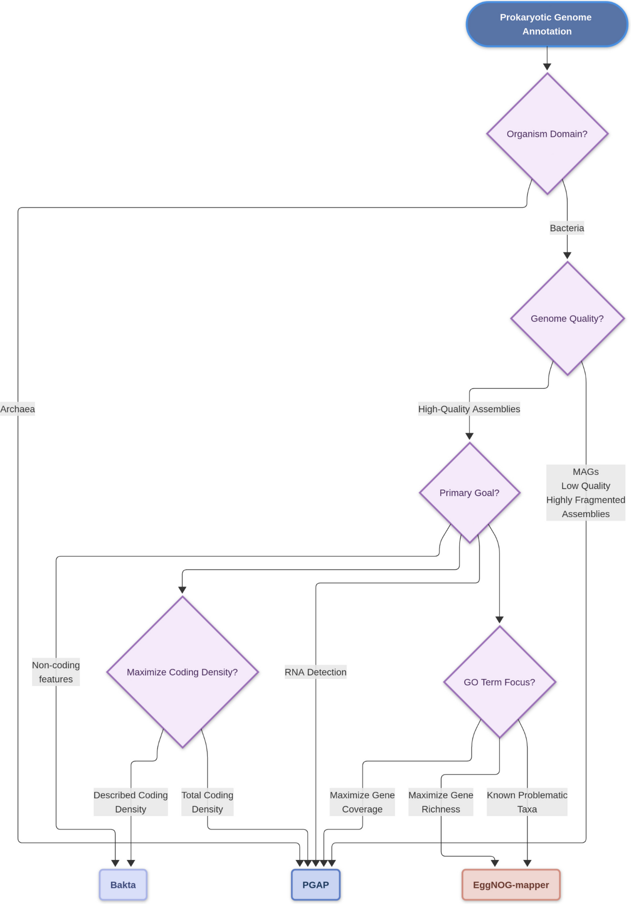

# 肠动心弦 · 宏基因组工具学习库

> 逐个工具学透：**工具信息 / 工具概述 / 算法实现 / VibeCoding 实战提示词**。面向硕博生与科研型医生；事实口径来自逐篇核校的顶刊论文解读（数字与原文一致）。
>
> 由微信公众号「[肠动心弦](#关注公众号)」出品。内容 AI 辅助整理并经人工核校，以英文原文与工具官方文档为准，不构成任何医疗建议。

## 工具清单

| 工具 | 一句话定位 | 教程 |
|---|---|---|
| Metax | 跨域（细菌/古菌/病毒/真菌）物种注释：全基因组覆盖度统计识破假信号 | [tutorials/metax](tutorials/metax/tutorial.md) |
| predmetab | 菌群大队列 × 代谢组小队列"拼接"，推断菌→代谢物→疾病通路（R 包） | [tutorials/predmetab](tutorials/predmetab/tutorial.md) |
| Bakta | 高质量细菌分离株注释首选（描述能力第一） | [tutorials/bakta](tutorials/bakta/tutorial.md) |
| PGAP | NCBI 官方流水线：古菌与"问题基因组"（MAG/碎片/移码）扛造之选 | [tutorials/pgap](tutorials/pgap/tutorial.md) |
| EggNOG-mapper | 直系同源功能注释：GO 词条最丰富，只注 CDS | [tutorials/eggnog-mapper](tutorials/eggnog-mapper/tutorial.md) |
| Prokka | 轻量元老（2014）：2026 基准已不推荐，低资源改用 Bakta light | [tutorials/prokka](tutorials/prokka/tutorial.md) |

## 选型速查：156,033 个基因组的基准结论

四款原核注释工具（Prokka / Bakta / EggNOG-mapper / PGAP）的系统评测结论浓缩成一张决策树（Jundzill M, Hölzer M, Mangul S, et al. *Genome Biol*. 2026;27:284，[doi:10.1186/s13059-026-04262-0](https://doi.org/10.1186/s13059-026-04262-0)，CC BY 4.0）：

*Figure 5 · 原核注释工具选型决策树*

- 高质量细菌分离株、目标是最大化已描述功能 → **Bakta**；
- 古菌或问题基因组（MAG、碎片、污染、移码）→ **PGAP**；
- 功能注释要覆盖广度 → **PGAP**；要词条丰富 → **EggNOG-mapper**（特定类群可互补）；
- 低资源环境 → **Bakta light** 或在线版；**Prokka 总体不再推荐**（捆绑数据库 2019-11 后停更）。

*Figure 1 · 评测设计与数据集全景：GTDB r207 代表物种 29,761 + 大肠杆菌 24,393 株 + 人工移码模拟 98,742 + 高质量 MAG 3,137*

## 每篇教程的读法

固定四段：**工具信息**（源码/论文/资源需求速查表）→ **工具概述**（解决什么问题、什么场景选它）→ **算法实现**（原理与关键数字，口径与论文一致）→ **VibeCoding 实战提示词**（把目标、约束、验收标准交给 AI 编程代理执行，每步附"怎么确认 AI 做对了"的校验点）。

> 提示词块均标注**【未实测】**：为"目标导向"写法（指向官方仓库，不硬编码命令），在真实环境跑通后会去掉该标注。欢迎提 issue 反馈你的实测结果。

## 版权说明

各篇教程正文为原创内容（首发于微信公众号「肠动心弦」）；图表按原论文许可转载并署名，仅作学术交流之用：

- Metax：CC BY-NC 4.0（Deng et al., *Cell* 2026）
- predmetab：gold OA（Fang et al., *Bioinformatics* 2026，转载须署名原作者）
- 注释工具评测图表：CC BY 4.0（Jundzill et al., *Genome Biol* 2026）

## 关注公众号

更多微生物组 × 临床医学科研解读持续更新，首发于微信公众号「**肠动心弦**」，欢迎微信搜索关注。
