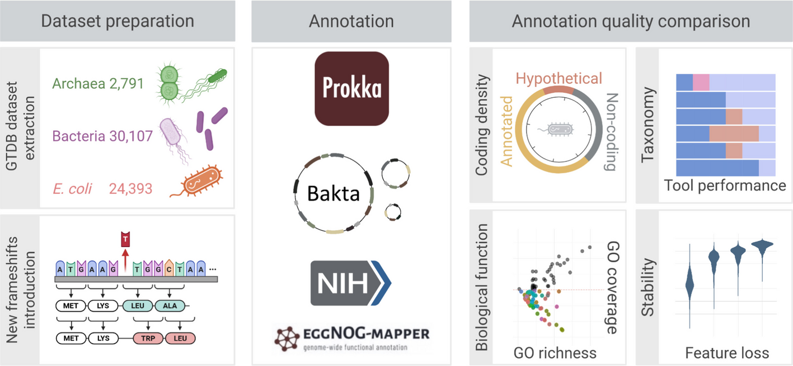

# Genome Biology 2026 · 原核注释工具基准评测：总览

> Jundzill M, Hölzer M, Mangul S, et al. Large-scale benchmarking of prokaryotic annotation tools across thousands of species. *Genome Biol*. 2026;27:284. [doi:10.1186/s13059-026-04262-0](https://doi.org/10.1186/s13059-026-04262-0)

四款工具各设一篇学习文档：[Bakta](bakta.md) ｜ [PGAP](pgap.md) ｜ [EggNOG-mapper](eggnog-mapper.md) ｜ [Prokka](prokka.md)

## 评测怎么做的

*Figure 1 · 评测设计与数据集全景*

数据集四块：**GTDB r207 代表物种 29,761 个**（细菌 163 门 26,970 + 古菌 20 门 2,791）；**大肠杆菌 24,393 株**（低分类变异的基线参照）；**人工移码模拟基因组 98,742 个**（0.5%/1%/2% 随机缺失）；**高质量细菌 MAG 3,137 个**（平均完整度 85.22%、污染 1.67%）。指标三组：编码密度（总/已描述/未描述）、RNA 特征（对照生物学期望判对错）、GO 功能注释（覆盖率与丰度）。

## 选型决策树

*Figure 5 · 原核注释工具选型决策树*

- 高质量细菌分离株、目标是最大化已描述功能 → **Bakta**；
- 古菌或问题基因组（MAG、碎片、污染、移码）→ **PGAP**；
- 功能注释要覆盖广度 → **PGAP**；要词条丰富 → **EggNOG-mapper**（特定类群可互补）；
- 低资源环境 → **Bakta light** 或在线版；**Prokka 总体不再推荐**（捆绑数据库 2019-11 后停更，其作者亦建议迁移 Bakta）。

---

> 本文首发于微信公众号「肠动心弦」。由 AI 辅助整理并经人工核校，内容以英文原文与工具官方文档为准；解读仅代表本号观点。图表引自 Jundzill et al., *Genome Biol* 2026（CC BY 4.0，原样使用，仅作学术交流）。
