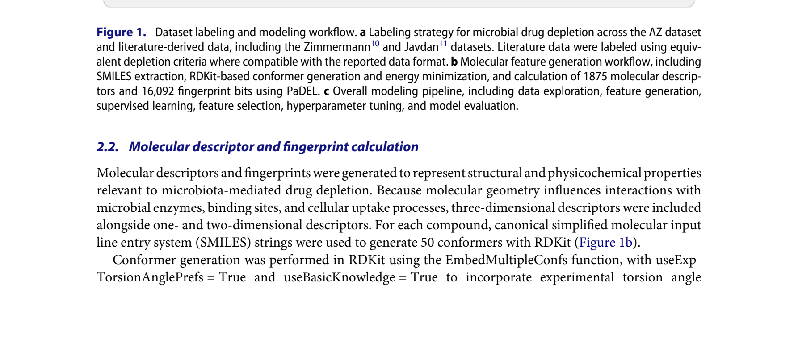

# BiotaPredictor：预测你的药会不会被肠道菌群"吃掉"

## 工具信息

| 项 | 内容 |
|---|---|
| 名称 | BiotaPredictor（菌群药物耗竭预测平台） |
| 源码 | https://github.com/benyamin-naranjani/biotapredictor |
| 在线工具 | https://biotapredictor.onrender.com/（免费；免费托管层，单次预测约 60 秒、闲置后有冷启动） |
| 论文 | Naranjani B, McCoubrey LE, Borde A, et al. *Gut Microbes*. 2026;18(1):2743953. [doi:10.1080/19490976.2026.2743953](https://doi.org/10.1080/19490976.2026.2743953)（gold OA） |
| 输入 / 输出 | SMILES 分子结构 → 四个模型的菌群耗竭概率 |
| 资源需求 | Python ≤3.12（锁定 rdkit 2023.9.5 / scikit-learn 1.4.2 / imbalanced-learn 0.12.2）＋ JRE（PaDEL 描述符计算）或 Docker 一条龙 |

## 仓库评估（2026-10-27 实地核验并实测）

| 维度 | 评定 | 依据 |
|---|---|---|
| 代码完整度 | ✅ | app.py（Flask 全流程）+ Dockerfile + requirements.txt（锁定版本）+ 4 个训练模型 .pkl + 特征集 .pkl + PaDEL-Descriptor.jar 及全部 Java 依赖（lib/，自带无需另下）+ 示例数据（test5.sdf + 预计算描述符） |
| 可执行性 | ✅ **实测通过** | 模型侧全流程本地跑通（见下方实测记录：RDKit 构象生成 → 4 模型加载 → 预测输出）；官方部署路径为 Docker（镜像内自装 JRE）；网页版在线可用（GET 验证） |
| 维护活跃度 | ⚠️ | 学术新库：0 star / 41 commits / 无 release / 无 tests 与 CI——随论文发布的官方实现，功能可用但建议锁定 commit 使用 |
| 许可与合规 | ⚠️ | 主体 AGPL-3.0（传染性许可，商用集成前需评估）；捆绑 PaDEL 为 LGPL-2.1 |

**结论：达标纳入**。可执行性经真实环境实测确认。

### 实测记录（2026-10-27，Python 3.10.12 + 论文锁定版本）

| 环节 | 结果 |
|---|---|
| RDKit 构象生成（app.py 原路径） | ✅ 阿司匹林 SMILES → 规范化 → 50 个 3D 构象 → 最低能量构象选出（E=38.68）→ SDF 写出，0.3 秒 |
| 模型加载 | ✅ 4 个 .pkl + 4 个特征集全部加载（0.6 秒）；模型为 sklearn Pipeline（内含预处理），特征数分别为 AZ_PC 59 / AZ_all 54 / integrated_PC 110 / integrated_all 126 |
| 预测（仓库自带示例分子） | ✅ 四模型输出：AZ_PC 耗竭 P=1.000、AZ_all 耗竭 P=0.900、integrated_PC 稳定 P=0.498、integrated_all 耗竭 P=0.511——**四模型出现分歧**，正好印证论文"最优模型随数据集而变"的结论；外部验证 12/12 的最优模型是 AZ_PC，实用时以它为主参考 |
| PaDEL 描述符计算 | ⚠️ 未实测：需 JRE（本机无）。仓库自带 jar 与依赖，装 JRE 即可（`apt install default-jre-headless`）或直接用官方 Dockerfile（镜像内已装） |
| 网页端提交 | ⚠️ 未实测提交：在线服务 GET 验证可用（表单在位）；本执行环境出网受限无法 POST，请读者自行验证（约 60 秒/次） |

## 工具概述：它解决什么问题

肠道菌既能代谢（分解）口服药物、也能把药物"囤"进菌体（生物蓄积），让药还没进血就打了折——这是"同药不同效"的隐形变量之一。机理证据早已扎实（2019 Nature 的 76 菌 × 271 药体外代谢图谱、2020 Cell 的个体化代谢地图），但药物**早期开发阶段一直缺一个"查菌群这笔账"的工具**。

BiotaPredictor（乌普萨拉大学 Naranjani 一作、UCL 药学院 Basit 通讯，联合阿斯利康团队）补上这一环：只看分子结构，输出四个模型的菌群耗竭概率，供先导优化、制剂策略与药代预测早期参考。

## 算法实现



*Figure 1 · 数据标注与建模全流程*

**数据**：阿斯利康 158 个化合物的体外粪菌孵育结果（统一标注后 36 个耗竭）；并入文献证据后整合集共 680 个化合物（252 耗竭）。**特征**：SMILES → RDKit 生成 50 个 3D 构象取最低能量 → PaDEL 计算 17,968 个特征（1875 个分子描述符 + 16,092 位指纹）。**模型**：五种算法（逻辑回归、平衡随机森林、SVM、LightGBM、XGBoost）× 四场景（{AZ, 整合} × {含, 不含指纹}）分层 10 折交叉验证比武，指标为平衡准确率 / F1 / AUPRC。

关键结果：受控 AZ 集上**逻辑回归 + 理化参数**拿下最高平衡准确率与 F1；模型间差异未达统计显著、最优模型随数据集而变（整合集上平衡随机森林更扛）。外部验证：12 个从未参与训练的化合物（含 ozanimod、甲氨蝶呤、他克莫司三个已上市药物），体外厌氧孵育实测，**最优模型 12/12 全部判对**（3 耗竭 + 9 稳定），其余模型最高 8/12——作者定性为"初步证据"（样本小且类别失衡）。

## VibeCoding 实战提示词

> 写法说明：目标、约束、验收标准讲清楚，让 AI 编程代理读官方仓库执行。**①②③ 已于 2026-10-27 真实环境实测**（Python 3.10.12 + 论文锁定版本）；④ 网页端未实测提交。

### ① 环境安装【已实测】

```text
帮我部署 BiotaPredictor（github.com/benyamin-naranjani/biotapredictor）。
优先方案：有 Docker 就按官方 Dockerfile 构建镜像（内含 JRE，一条龙）。
无 Docker 则：Python 3.10/3.11 虚拟环境 + pip 安装锁定版本
numpy==1.26.4 rdkit==2023.9.5 scikit-learn==1.4.2 imbalanced-learn==0.12.2 pandas==2.2.2，
并安装 JRE（apt install default-jre-headless，PaDEL 需要它算描述符）。
约束：不要用 Python 3.13+（rdkit 2023.9.5 没有对应轮子，实测装不上）；
pip 直连超时就换镜像源。
验收：能 import rdkit/sklearn/imblearn 且 java -version 有输出。
```

**校验点**（实测值参考）：`python -c "import rdkit; print(rdkit.__version__)"` 输出 2023.09.5；`java -version` 正常返回。

### ② 构象生成【已实测】

```text
用仓库 app.py 的逻辑处理一个 SMILES（示例：阿司匹林 CC(=O)OC1=CC=CC=C1C(=O)O）：
RDKit 去立体化学 → 规范化 → 加氢 → EmbedMultipleConfs 生成 50 个构象
（useExpTorsionAnglePrefs=True, useBasicKnowledge=True）→ MMFF/UFF 算能量
选最低能量构象 → 写 SDF。把每一步的中间结果打印给我。
```

**校验点**（实测值参考）：构象数 = 50；阿司匹林最低能量约 E=38.68；SDF 文件生成且可被 RDKit 读回。

### ③ 模型预测【已实测】

```text
加载仓库自带的 4 个模型（AZ_PC/AZ_all/integrated_PC/integrated_all.pkl）与
对应特征集 .pkl，对仓库自带的 test5_all_descriptors（预计算描述符表，跳过 PaDEL 步骤）
按 app.py 的逻辑预测：pd.read_csv → 去掉 Name 列 → SimpleImputer(mean) →
每个模型 predict + predict_proba。输出四模型分类与耗竭概率的对照表。
验收：四行结果齐全，概率值在 [0,1]。
```

**校验点**（实测值参考）：模型加载 <1 秒；示例分子四模型输出 P(耗竭) ≈ 1.000 / 0.900 / 0.498 / 0.511——**出现分歧是正常现象**，以外部验证最优的 AZ_PC 为主参考。

### ④ 网页端使用【未实测提交】

```text
打开 biotapredictor.onrender.com，粘贴 SMILES 提交，等待约 60 秒读结果。
注意免费托管层闲置后会冷启动，首次等待更久。
```

**校验点**：页面正常返回四模型结果表；长时间无响应先刷新重试一次。

## 常见坑（全部为实测踩到或仓库明确声明）

1. **Python 版本上限**：锁定依赖 rdkit==2023.9.5 无 Python 3.13 轮子（实测报 "No matching distribution"），用 3.10/3.11（官方 Dockerfile 即 python:3.11-slim）；
2. **Ubuntu venv 缺件**：python3.10 -m venv 可能报 ensurepip 不可用（需 apt install python3.10-venv），或改用 virtualenv 工具建环境（实测绕过）；
3. **JRE 是隐藏依赖**：PaDEL 是 Java 工具，仓库自带 jar 与 lib 依赖但**不带 JRE**——本地跑完整流程必须先装；用 Docker 则无此问题；
4. **网络环境**：PyPI 直连超时的环境换镜像源（实测清华镜像可用）；
5. **requirements.txt 为 UTF-16 编码**（Windows 导出痕迹，实测 `file` 确认）：pip 能识别 BOM，但 grep/cat/部分编辑器会显示乱码，跨平台协作建议先 `iconv -f UTF-16 -t UTF-8` 转码；
6. **四模型会分歧**（实测亲历）：不同数据集训练的模型对同一分子可能给出相反分类——这不是 bug，论文结论就是"最优模型随数据集而变"；解读时以外部验证最优的 AZ_PC 为主、其余为参考，必要时结合体外实验确认；
7. **网页端冷启动**：Render 免费层闲置休眠，首次访问等待明显更长（官方 README 口径）。

## 版权与声明

> 本文首发于微信公众号「肠动心弦」。本文内容以英文原文与工具官方文档为准；解读仅代表本号观点。图表引自 Naranjani et al., *Gut Microbes* 2026（gold OA，转载须署名原作者）。
