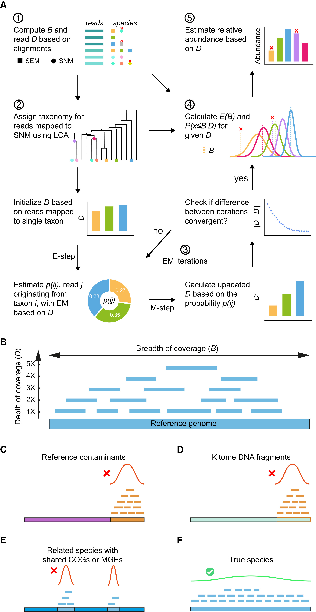
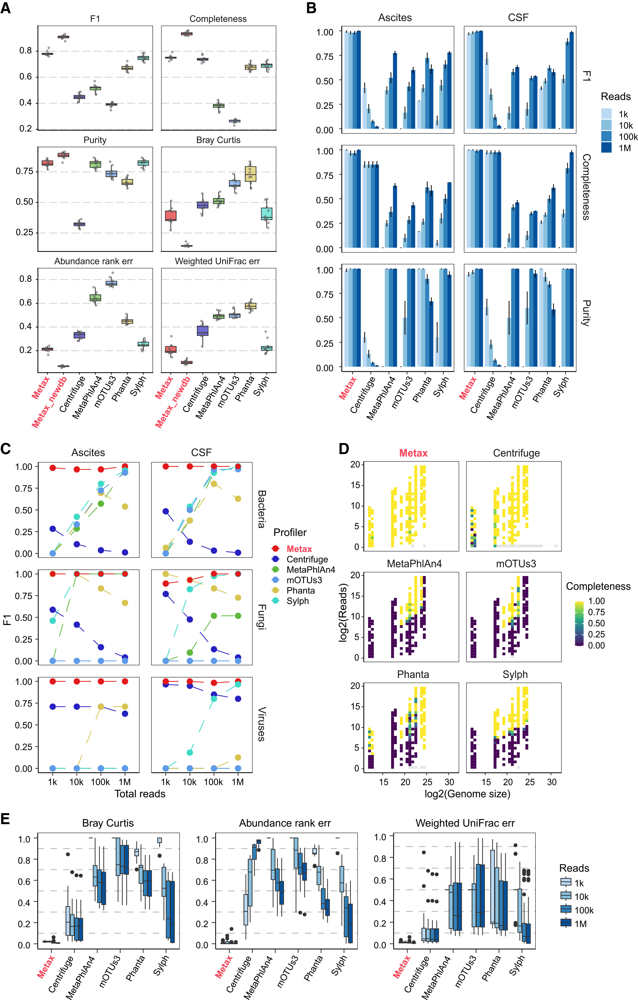
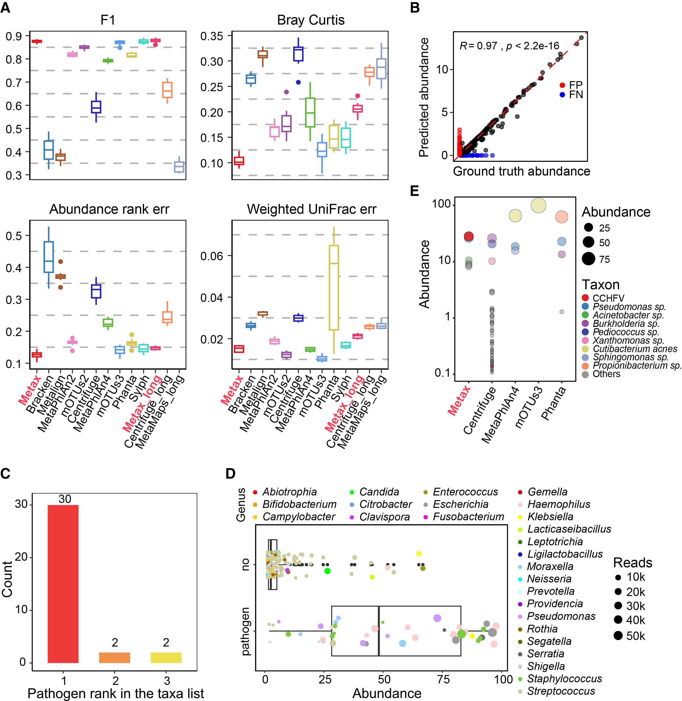
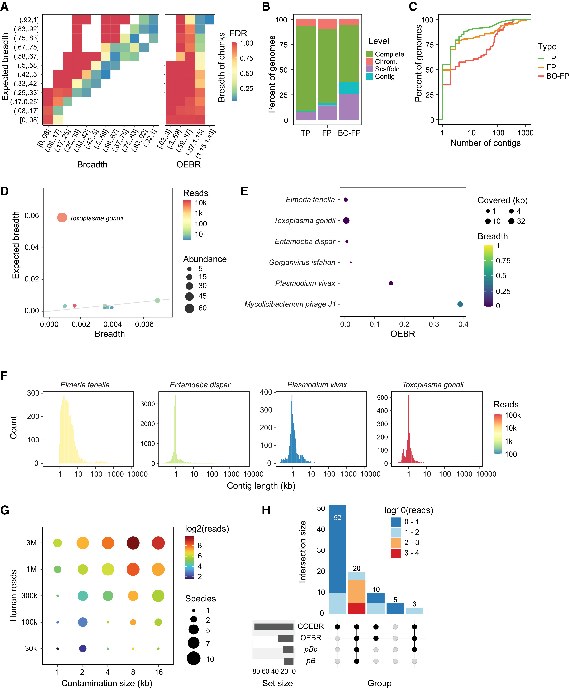
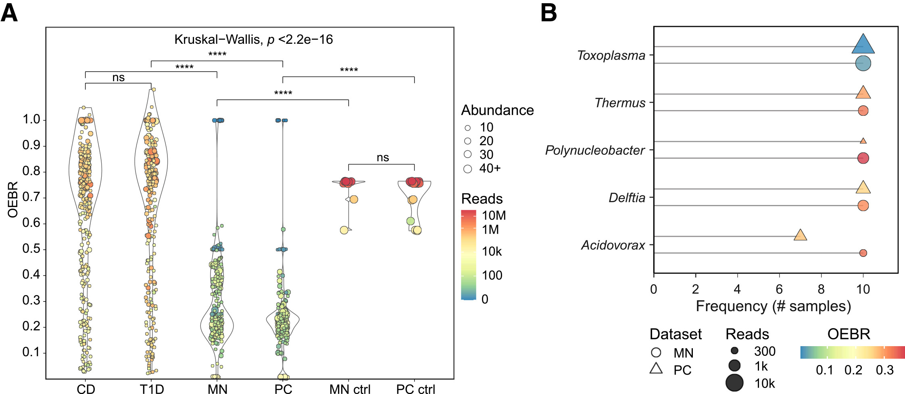
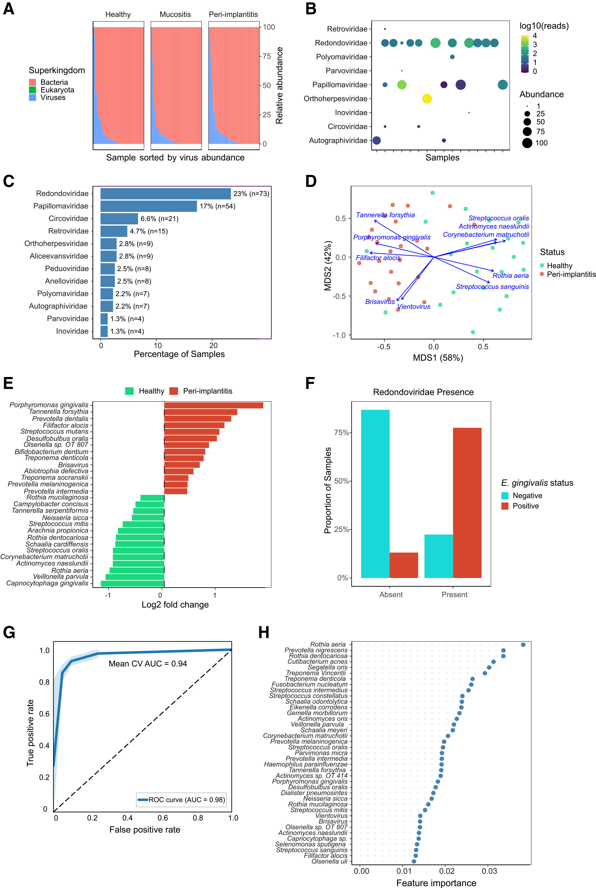

# Metax：用覆盖度统计揪出宏基因组注释里的"假信号"

> 跨域（细菌/古菌/病毒/真核微生物）物种注释工具 ｜ Cell · 2026 ｜ [论文原文](https://doi.org/10.1016/j.cell.2026.08.024) ｜ [工具源码](https://github.com/hzi-bifo/Metax)
>
> 本文首发于微信公众号「肠动心弦」。

---

**Cell · 2026-10-29 · Resource · 生信工具（细菌/病毒/真菌/古菌跨域）**

> **导读**：德国亥姆霍兹感染研究中心团队在 Cell 发表跨域宏基因组注释工具 Metax：用"全基因组覆盖度"统计检验区分真信号与假信号，600 多个样本的基准测试中种级 F1 平均提升 55%，低至一千条读段依然稳健，还能识破肿瘤测序数据里的污染信号。

## 研究背景：注释容易，注准难

鸟枪法宏基因组测序让研究者不经培养直接读出整个微生物群落，而分类学注释（回答"样本里有哪些物种、各占多少"）是这一切的地基——群落组成、丰度比较、临床研究都建立在它之上。

但种级注释一直是件"脏活"。短读段在近缘物种之间"到处都比对得上"，归属歧义大；低生物量的临床样本里微生物读段本就稀少，试剂盒带来的试剂 DNA（业内戏称 kitome）和残留宿主序列会把真信号淹没；更麻烦的是参考数据库本身就有病——GenBank 中被系统性鉴定出的污染条目以百万计，混入参考基因组的外源片段会凭空"注释"出根本不存在的物种。病毒和真菌因为基因组小、与参考库差异大，一直是重灾区。

近日，邓志罗（Zhi-Luo Deng）与 Alice Carolyn McHardy 团队（德国亥姆霍兹感染研究中心）在 Cell 发表 Resource 文章，推出跨域（细菌、古菌、病毒、真核微生物）物种注释工具 Metax，正面回应了这些问题。

## 方法速览：五步流程与一把"覆盖度标尺"

*Figure 1 · Metax 工作流程与四类假信号的识别原理*

Metax 的输入是鸟枪法测序读段，输出是带置信过滤的物种丰度谱，流程分五步：

1. 读段比对到参考基因组库，按比对质量过滤；对每个候选物种计算覆盖深度、覆盖广度和分块广度；
2. 区分"有专属唯一比对读段的物种"（SEM）与"没有"的物种（SNM），后者保守处理；
3. 多条读段同时可比到多个物种时，用期望最大化算法（EM，通俗说就是按各物种专属读段的比例反复分摊"共享读段"）估计种级深度；跨物种共享的歧义读段按最近公共祖先（LCA）上提；
4. 关键一步——覆盖度统计检验（下文详述）；
5. 过滤缺乏全基因组支持的物种后，计算相对丰度。

第 4 步的 OEBR（观察/期望覆盖广度比值）是全文的题眼，可以这样理解：把一条参考基因组想成一条长铁轨。真正存在于样本里的物种，测序读段会像雨点一样随机撒满整条铁轨；而假信号——参考基因组里混入的污染片段、试剂带进来的 DNA、近缘物种共享的保守基因或移动元件——读段只会落在某一小段上。Metax 用随机抽样模型算出"这个测序深度下期望覆盖多广"，与实际观察值相比：比值接近 1，说明读段铺满了全基因组，真；极端偏离，说明信号是局部的，标记为可疑假阳性。配套的 COEBR 把基因组切块逐段检验，专抓"局部聚集"。计算成本上，2 Gb 样本约 8 分钟、峰值内存 55 GB，与标记基因法相当；"分数索引"模式可把内存压到约 5 GB、4 分钟/样，普通工作站就能跑。

## 核心发现

### 多场景基准：种级注释全面领先

*Figure 2 · 模拟肠道与临床数据集上的综合性能对比*

在基于真实肠道丰度谱模拟的多域群落（含真菌与噬菌体）上，Metax 的种级 F1 比 mOTUs3、MetaPhlAn4、Sylph、Phanta、Centrifuge 等主流工具高出 4%–102%，种级 Bray-Curtis 距离低 5%–47%。在 CAMI II 海洋数据集（复杂群落、每样 5 Gb 长短读混合）上，Metax 拿到全场最高的种级 F1（0.88，其余工具 0.34–0.88），种级丰度与真值的 Pearson 相关系数 r = 0.97。

*Figure 3 · CAMI II 与临床病原检出数据上的表现*

作者也诚实展示了"参考库缺物种"的极端场景：土壤模拟群落中 76% 的物种不在参考库里，此时所有工具的种级表现都不理想（Metax 的 0.24 仍为最高），但属级（F1 0.69）与科级（0.70）Metax 均为最佳——工具再好也不能凭空注释出参考库里没有的物种，这份坦诚值得肯定。

### 低生物量与临床场景：一千条读段依然稳

在模拟腹水与脑脊液样本（每样 1 千至 100 万条微生物读段）上，Metax 的 F1 稳定在 0.99 左右，丰度估计的 Bray-Curtis 距离仅 0.016——比其他工具低 13–50 倍，而且细菌、真菌、病毒全都能检出来（部分工具在浅深度下整类病毒漏检）。

真实临床数据同样能打：34 例病原阳性的下呼吸道感染长读段样本全部正确检出、7 例阴性零误报；88% 的样本里病原体丰度排第一，平均占群落近半（52.3%）。在 CAMI II 病原挑战样本中，Metax 把克里米亚-刚果出血热病毒报为最丰富的分类群（28.16%），而 Centrifuge 只给出 0.14% 的丰度——同样的"检出"，临床可见性天差地别。

### 假阳性"三连识破"：覆盖度统计的用武之地

*Figure 4 · Metax 的假阳性识别能力*

**其一，识破参考基因组污染。** 在只含人类 DNA 的 GIAB 全基因组测序数据上（理论上不该有任何微生物），Metax 与 Centrifuge 都"检出"了刚地弓形虫等 5 个微生物——Metax 的覆盖度统计把 5 个全部标为假阳性（OEBR < 0.2）。追查发现，支持读段全部落在参考基因组中的单条短 contig 上：这些高度碎片化的原生动物参考组装里，混进了尚未被表征的人类基因组序列。相关两个噬菌体参考近期已被 NCBI 标注"来源未验证"。

**其二，掺入实验定量验证。** 作者把 1–16 kb 的人源片段人为插入 50 个细菌/古菌参考基因组，再用纯人数据去注释：94%（85/90）的污染信号被覆盖度统计识破，小片段插入约 10 条支持读段即可甄别——说明这套检验在极低深度下依然有效。

**其三，给肿瘤"微生物组"争议添证。** 以克罗恩病与 1 型糖尿病两个肠道队列为对照（其分类群的 OEBR 紧凑围绕 1），黑色素瘤/非小细胞肺癌与胰腺癌的血浆 cfDNA 样本中，"微生物信号"大量集中在极端 OEBR 区间，且高频出现 Thermus、Delftia、Acidovorax 等文献反复报告的试剂污染属。这为"肿瘤测序中的微生物信号可能大部分源于试剂污染与参考错拼"的近年争议提供了新的定量证据。作者同时谨慎声明：OEBR 证明的是"全基因组层面的序列支持"，不等于生物学起源，cfDNA 场景的结论仍需实验对照与正交验证。

*Figure 5 · 肿瘤血浆 cfDNA 样本中的覆盖度分布与高频"检出"属*

### 生物学发现：小基因组病毒与宿主的共生线索

*Figure 6 · 口腔微生物组队列分析：跨域特征与疾病关联*

工具之外，论文用 317 个口腔样本（91 名受试者）做了示范应用。Redondoviridae 是一类基因组不足 10 kb 的小病毒，Metax 在 23% 的样本中检出了它，为病毒优势群落中的第一大科；它与自己的宿主——常在口腔炎症时定居牙周袋的齿龈内阿米巴——共现的比值比高达 OR = 22.3（阿米巴没有可用基因组，作者用其 18S rDNA 序列反推验证）。种植体周围炎与健康位点的差异分析中，经典"红色复合体"细菌全部显著升高，外加一种 Redondo 病毒；用跨域注释谱训练的随机森林区分病变与健康，AUC 0.94。团队还检出 TM7 小基因组菌与其宿主放线菌的成对出现——跨域的生态共生关系，直接从一张注释谱里浮现出来。

## 总结与意义

- **方法论**：Metax 把物种注释从"比对得分"推进到"证据评估"——每条物种判定都附带全基因组覆盖证据与统计置信，并自带污染识别能力；
- **实用性**：完全开源（github.com/hzi-bifo/Metax），基准数据与脚本全部归档 Zenodo；分数索引模式让普通服务器可用；分类体系可切换 GTDB/ICTV；
- **领域价值**：在低生物量临床样本、肿瘤微生物组争议、病毒组检测这些"噪声重灾区"，提供了一个可操作的真伪检验工具；
- **作者展望**：菌株级解析，以及用覆盖度统计大规模筛查参考库中的污染组装。

## 局限性（作者自陈）

1. 依赖参考库的完整性与准确性：库外物种可能漏检、上提至高级阶元或误归近缘；
2. OEBR 需结合样本类型解读：RNA 文库、降解 DNA、仅由保守区代表的高分化菌株可能违反期望覆盖模式，带来假阴性；
3. 极低读段数下，局部信号可能因信息不足而漏检；
4. 肿瘤 cfDNA 的污染结论需实验对照与正交验证支持。

## 参考文献

1. Deng Z-L, Safaei N, McHardy AC. Metax enables accurate cross-domain taxonomic profiling of metagenomes. *Cell*. 2026;189:1–16. doi:10.1016/j.cell.2026.08.024
2. Steinegger M, Salzberg SL. Terminating contamination: large-scale search identifies more than 2,000,000 contaminated entries in GenBank. *Genome Biol*. 2020;21:115.
3. Eisenhofer R, et al. Contamination in low microbial biomass microbiome studies: issues and recommendations. *Trends Microbiol*. 2019;27:105–117.
4. Shaw J, Yu Y-W. Rapid species-level metagenome profiling and containment estimation with sylph. *Nat Biotechnol*. 2024;43:1348–1359.
5. Kennedy KM, et al. Questioning the fetal microbiome illustrates pitfalls of low-biomass microbial studies. *Nature*. 2023;613:639–649.

---

原文：https://doi.org/10.1016/j.cell.2026.08.024 ｜ 工具：https://github.com/hzi-bifo/Metax

> 本文由 AI 辅助整理并经人工核校，内容以英文原文为准；解读仅代表本号观点，不构成任何医疗建议。文中图表引自 Deng et al., *Cell* 2026（CC BY-NC 4.0，仅作学术交流之用）。

你做过低生物量样本吗？被 kitome 坑过吗？评论区聊聊👇
