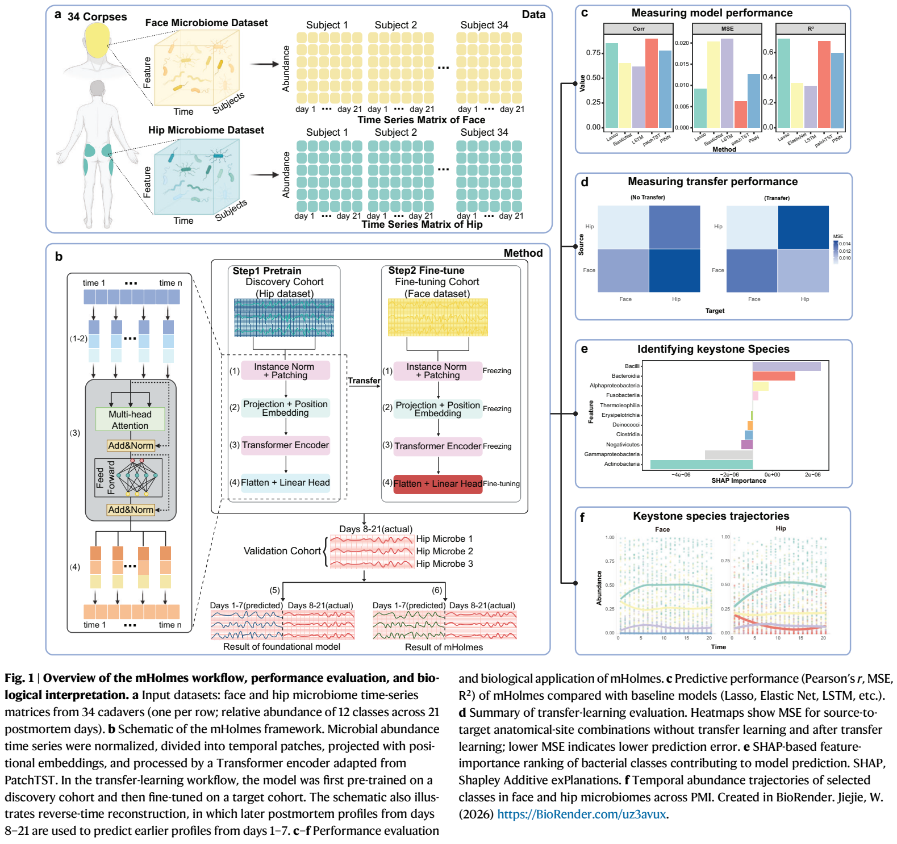
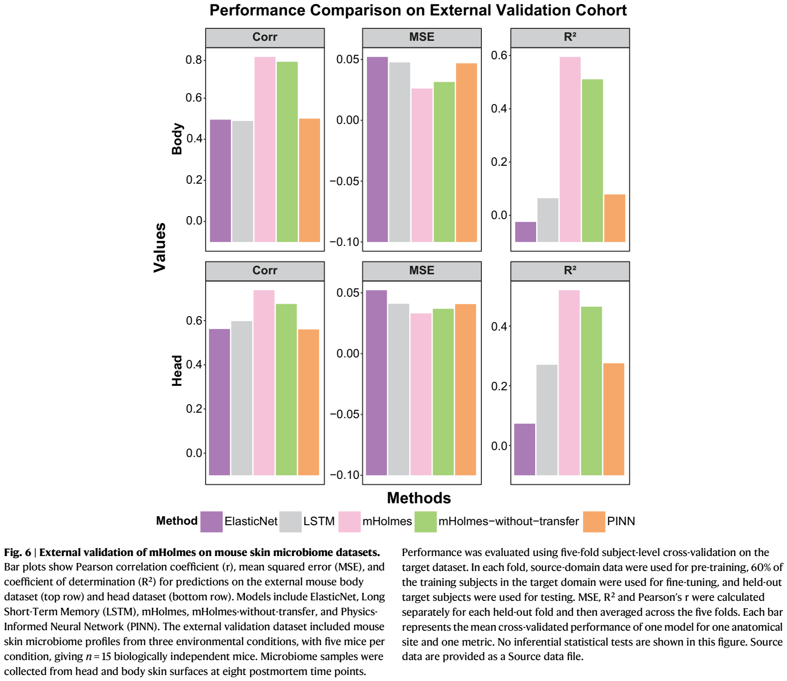

# 论文复现：mHolmes 法医菌群时序预测框架（Nat Commun 2026）

> 这是一篇「论文复现式」教程：论文官方仓库（MIT）自带 13 个示例 csv + `mhm` CLI 七种模式 + 钉版依赖清单，是四仓库中工程化程度最高的一个。**部分实测**（2026-11-20 本站真实环境）：块 1 环境搭建 ✅、块 2 的 `mhm tlpredict` ✅（示例数据微调 36 epoch 跑通、模型导出）、`mhm tlmae` ⚠️ 部分完成（CPU 超时终止但产出两个 fold 的分日 MAE）；块 3–4 未实测。实测详见「demo 实测记录」。

## 论文信息

| 项 | 内容 |
|---|---|
| 论文 | Han J, Zhang Y, Zhang H, et al. mHolmes improves cross anatomical cadaveric microbiome forecasting for postmortem interval estimation. *Nat Commun*. 2026;17:11172. [doi:10.1038/s41467-026-77510-3](https://doi.org/10.1038/s41467-026-77510-3)（PMID 42946700，CC BY-NC-ND 4.0） |
| 分析代码 | https://github.com/HUST-NingKang-Lab/mHolmes（**MIT**）；Zenodo [10.5281/zenodo.21224080](https://doi.org/10.5281/zenodo.21224080)（v1.0.1 "NCOMMS final version"，含 wheel） |
| 数据 | 人尸：PRJNA973116（Burcham et al. 2024，36 具/3 场地/2016–2017 四季/3,780 样本）；小鼠外部验证：Qiita 10141 = PRJEB11472 / ERP012866 |
| 研究体系 | PatchTST 迁移学习：34 具尸体 face/hip 皮肤 16S × 21 日采样 × 12 类级特征；跨解剖部位预测 + 反向时间重建 + SHAP 可解释；PMI 误差最低 1.48 天 |

## 仓库评估（2026-11-20 实地核查：GitHub API + tree + README + Releases）

| 维度 | 评定 | 依据 |
|---|---|---|
| 代码完整度 | ✅ | 46 个文件、2,040,349 字节，Python；README 19,726 B（系统要求/conda 安装/7 种 CLI 模式/输入格式表/输出文件说明/PatchTST 配置表/维护人联系方式）；requirements.txt（numpy 2.4.1、torch 2.10.0、transformers 5.0.0 等 6 项钉版）+ pyproject.toml（console_script `mhm`）；标准 src/ 布局 |
| 可执行性 | ✅ | 仓库自带 13 个示例 csv（corpse_data/：source_hip、target_face、*_keytaxa、val_head 等），与 README 演示命令逐一对应；CLI 七子命令（predict/tlpredict/shap/tlshap/mae/tlmae/mask）实现在 src/mHolmes/cli.py；Releases v1.0.1 wheel（32,471 B） |
| 维护活跃度 | ✅ | 创建 2026-01，最后 push 2026-07（论文定稿版），61 commits，2 Releases |
| 许可与合规 | ✅ | MIT（Copyright (c) 2026 NingLab），GitHub 正确识别 |
| 仓库↔论文对应 | ⚠️ | README 未见 DOI——对应关系依论文 Code availability 声明；旁证：release v1.0.1 命名 "NCOMMS final version"，内容（PatchTST、PMI<±2 天、34 具尸体、SHAP）与论文要点吻合 |

**结论：条件纳入**——四个评估仓库中唯一完整度与可执行性双 ✅，作为「环境搭建 → CLI 实测路径」教程纳入（本站安装未完成，实测留待复验）。

## 研究问题与核心发现

*Figure 1 · mHolmes 工作流（整图引自 Han et al., Nat Commun 2026, CC BY-NC-ND 4.0，仅作学术交流之用）*

1. **跨部位迁移降误差**：hip-to-face R²=0.46；迁移使 MSE 0.020→0.014；Bray–Curtis 中位 0.39 vs 基线 0.51（校正 p=0.019）；
2. **PMI 误差 ±3 天 → 1.48 天**（95% CI 0.97–1.99，day 11）；7 个 SHAP 关键类群 ≈ 全特征（1.51 天）；活跃腐烂期最准（2.12–2.85 天）；
3. **七类指示菌与分解生物学对齐**：Gammaproteobacteria day 1→9 冲至 ~55%；Clostridia day 3–14 从 5%→15%；Actinobacteria 晚期峰 10%；Deinococci 为暴露标记；
4. **跨物种验证**：小鼠 body r=0.82、R²=0.59（ElasticNet R²<0）；R² 停在 0.5–0.6（作者如实标注方差上限）。

*Figure 6 · 外部验证（整图引自 Han et al., Nat Commun 2026, CC BY-NC-ND 4.0，仅作学术交流之用）*

## 分析流程（论文做了哪些分析 ↔ 仓库 CLI 模式）

| 分析环节 | `mhm` 子命令 | 说明 |
|---|---|---|
| 前向预测 | `predict` | 单队列微生物时间序列预测（输入 csv：行=时间点） |
| 迁移预测 | `tlpredict` | 预训练（source）+ 仅投影头微调（target） |
| SHAP 解释 | `shap` / `tlshap` | 单模型 / 迁移模型的类级特征重要性 |
| PMI 误差 | `mae` / `tlmae` | 分日 MAE 评估（单模型 / 迁移 vs 不迁移对比） |
| 遮蔽敏感性 | `mask` | 输入遮蔽 0–60% 的稳定性分析 |

## 复现路径（VibeCoding）

### 块 1 · 环境搭建（✅ 已实测 2026-11-20）

> **提示词**：克隆 github.com/HUST-NingKang-Lab/mHolmes，阅读 requirements.txt（torch==2.10.0、transformers==5.0.0、numpy==2.4.1、pandas==3.0.0、scikit_learn==1.8.0、shap==0.46.0）。创建独立 conda env（Python 版本按 pyproject.toml 要求），CPU 版 torch 从官方 cpu wheel 源安装、其余从 PyPI 分源安装（单源混装会因 torch index 无 shap 报错）。随后 `pip install -e .` 注册 `mhm` 命令。约束：不全局安装；版本严格按钉版。验收标准：`mhm --help` 列出 7 个子命令。
>
> **校验点（实测结果）**：`mhm --help` 输出 predict/tlpredict/shap/tlshap/mae/tlmae/mask 七子命令 ✅。
>
> **实测版本弹性说明**：本站为 Python 3.13 + torch 2.12.0+cu130 / numpy 2.5.4 / pandas 2.3.3 / scikit-learn 1.9.0 / transformers 5.11.0（均比钉版更新）——框架对版本上浮有容忍度，块 2 实测跑通即为佐证；严格复现请仍按钉版。
>
> **本站踩坑实录**：torch 与 shap 单源混装报 "No matching distribution found for shap"——必须分源（torch 走 pytorch cpu index、其余走 PyPI）。

### 块 2 · 示例数据跑通（✅ 已实测 2026-11-20）

> **提示词**：用 corpse_data/ 下的 source_hip.csv 与 target_face.csv 按 README 的 transfer 流程示例执行 `mhm tlpredict ./corpse_data/source_hip.csv ./corpse_data/target_face.csv --export_path="./result"`，报告训练摘要与导出文件。验收标准：训练完成、transfer_model/ 目录生成。
>
> **校验点（实测结果）**：训练 36 epoch、train_runtime 11.75s、train_loss 0.01686；result/transfer_model/ 模型分片导出 ✅。
>
> **tlmae ⚠️ 部分实测**：`mhm tlmae ... --export_path="./result"` 在 CPU（280 s 时限）未跑完双模型训练即被终止，但已产出 result/MAE/transfer_1_metrics.csv 与 transfer_2_metrics.csv（两个 fold 的分日 MAE）。**实测数字**：示例数据下分日 MAE 约 5.2–9.2 天——比论文的 1.48 天大一个量级，原因即"13 个示例 csv 是精简演示数据，非论文 34 具 × 21 天全量"；这恰好实证了"示例数据 ≠ 论文结果"（全量数据可从 PRJNA973116 下载后复跑）。

### 块 3 · SHAP 与遮蔽敏感性

> **提示词**：对块 2 的迁移模型执行 `mhm tlshap`，输出七类菌（Gammaproteobacteria/Bacilli/Clostridia/Bacteroidia/Actinobacteria/Alphaproteobacteria/Deinococci）的重要性排序；随后 `mhm mask` 做 0–60% 遮蔽敏感性，确认中位 MSE 稳定（论文 Supplementary Fig. 2 口径）。验收标准：SHAP 排序含七类且前三与论文一致（Gammaproteobacteria/Bacilli/Clostridia）。
>
> **校验点**：SHAP 值文件生成；mask 输出的 MSE 随遮蔽比例无明显发散。

### 块 4 · 结果对照

> **提示词**：将块 2–3 产出与论文 Fig 2（迁移性能）、Fig 4（PMI MAE 分日）、Fig 5（迁移 vs 不迁移 MAE）、Fig 6（小鼠外部验证）逐面板对照，输出三列覆盖表：论文面板 / 本地产物 / 一致性说明。论文关键数字锚点：MSE 0.014、R²=0.46、MAE 1.48 [0.97–1.99]、活跃期 2.12–2.85。验收标准：覆盖表完整，数值差异如实标注（示例数据 vs 论文数据的天然差异，不臆断复现成功）。
>
> **校验点**：覆盖表存在；方向性结论（迁移优于不迁移、活跃期最准）在示例数据上可复验。

## 常见坑

1. **依赖钉版极新**：torch 2.10.0/transformers 5.0.0/numpy 2.4.1 为 2026-08 前后版本——务必独立 conda env，勿污染基础环境；torch 与其余包分源安装（本站实录）；
2. **双份脚本拷贝**：仓库根目录 `mHolmes/` 与 `src/mHolmes/scripts/` 有 7 个脚本双份——一律以 `pip install -e .` 后的 `mhm` CLI 为准；
3. **README 无 DOI**：仓库↔论文对应依论文 Code availability 声明 + release v1.0.1 "NCOMMS final version" 旁证——引用格式建议写明这一证据链；
4. **示例数据 ≠ 论文完整数据**：13 个示例 csv 是精简演示（论文用 34 具 × 21 天 × 12 特征全量数据，来自 PRJNA973116 公开数据集，可自行下载全量复跑）；
5. **16S 边界（论文自陈）**：SHAP 类群是候选标志物，16S 不能直接证明代谢活性——解读产出时保持这层限定。

## 版权与声明

- Figure 1/6 整图引自 Han J, et al. *Nat Commun* 2026（CC BY-NC-ND 4.0，仅作学术交流之用）；
- 分析代码 MIT License；论文本体 CC BY-NC-ND 4.0。

> 本文内容以英文原文与工具官方文档为准；解读仅代表本号观点。
