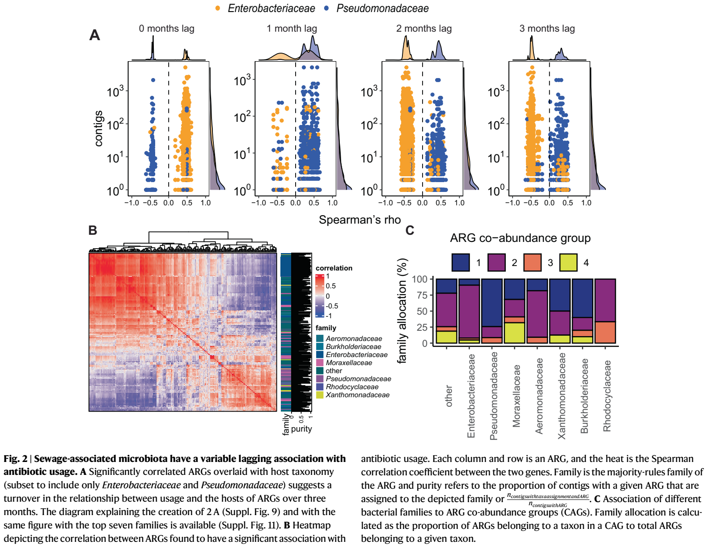

# 论文复现：污水耐药监测信号的滞后结构（Nat Commun 2026）

> 这是一篇「论文复现式」教程：论文官方仓库的 demo 脚本（合成数据、自包含）**已在本站真实环境跑通**（实测记录见下），本文给出从环境到 demo 复现的路径，并如实标注哪些部分无法复现论文真实数据结果。

## 论文信息

| 项 | 内容 |
|---|---|
| 论文 | Brown CL, Rumi MA, McDaniel L, et al. Resistance indicators in sewage microbiota mirror clinical antibiotic use with temporal lag linked to host. *Nat Commun*. 2026;17:11474. [doi:10.1038/s41467-026-78142-3](https://doi.org/10.1038/s41467-026-78142-3)（PMID 42988813，CC BY-NC-ND 4.0） |
| 分析代码 | https://github.com/clb21565/WBS_use_resistance_modeling（**MIT**） |
| 数据 | SRA PRJNA1083020 / PRJNA1441618（污水宏基因组）；MAGs PRJNA1497497；处方数据为按住址去标识汇总的门诊处方率 |
| 研究体系 | 单一污水厂整年每周 2 次 shotgun × 5 年门诊处方数据：286 个 ARGs 与用量显著关联；肠杆菌科同步、假单胞菌科滞后 1–3 个月 |

## 仓库评估（2026-11-20 实地核查 + 本站实测）

| 维度 | 评定 | 依据 |
|---|---|---|
| 代码完整度 | ✅ | 6 个文件、30,516 字节，纯 R；README 1,633 B 写明 demo 用途、9 个 CRAN 依赖安装命令、运行方式（`source("mag_seasonality_modeling_demo.R")`）；LICENSE 在位 |
| 可执行性 | ✅（demo）/ ⚠️（真实数据管线） | demo 脚本自包含合成数据、README 声称 <1 分钟跑通——**本站实测属实**（见下）；真实数据脚本引用的 4 个输入 csv 不在仓库且未交代获取途径 |
| 维护活跃度 | ✅ | 创建 2023-11，最后 push 2026-11（本周）；issue #1（README 标题修订）作者未回应 |
| 许可与合规 | ✅ | MIT（Copyright (c) 2024 clb21565），GitHub 正确识别 |
| 仓库↔论文对应 | ✅ | README 引用论文全称 + DOI 10.1038/s41467-026-78142-3 |

**结论：条件纳入**——demo 可直接跑通（已实测），真实数据管线不可复现且数据来源未交代；作为「demo 实测 + 真实管线缺口说明」教程纳入。

## 研究问题与核心发现

*Figure 2 · 滞后相关模式（整图引自 Brown et al., Nat Commun 2026, CC BY-NC-ND 4.0，仅作学术交流之用）*

1. **286 个 ARGs**（FDR 校正）与门诊处方量显著关联，模式分四类（正/负/滞后/非滞后）；
2. **肠杆菌科 ARGs 同步响应**；**假单胞菌科 ARGs 滞后 1–3 个月**——生态位不同的两类菌对同一选择压的"记账周期"不同；
3. 药物化学性质塑造滞后结构：β-内酰胺（不稳定）直接相关超过 49 个 ARGs；大环内酯滞后 2 个月 46 个；SXT 滞后 1 个月 44 个（Fisher p<0.0001）；
4. 嵌套模型（校正季节性/污水特征后）锁定 Pseudomonas MAG 动态 ↔ SXT 滞后使用的稳健关联（43 个物种级 MAGs，11 种）。

## demo 实测记录（2026-11-20，本站真实环境）

| 项 | 内容 |
|---|---|
| 环境 | R（miniforge3 发行版）+ tidyr/dplyr/data.table/plyr/ggplot2/mgcv/zoo/lubridate/stringr/purrr 全部可用；**ggthemes 需补装**（README 未列） |
| 命令 | `Rscript mag_seasonality_modeling_demo.R` |
| 耗时 | 秒级（README 声称 <1 分钟，属实） |
| 产物 | 控制台输出 Model 2/3/4 逐 MAG 拟合系数与 AIC 对比表（gs12/gs43/gs77 三个合成基因组 × 季节性/SXT/协变量三模型）；`Rplots.pdf`（65,182 字节，绘图产物，路径：脚本工作目录） |
| 结果抽查 | AIC 表结构与 README 声明的"Models 2, 3, and 4 from the manuscript"对应；Model 4（+SXT+协变量）在 gs43 上 R²=0.9789 为三者最高——与论文"嵌套模型锁定 Pseudomonas–SXT 滞后关联"的方法逻辑一致 |
| 定性 | **合成数据演示跑通**——不构成论文真实结果的复现（README/论文均明确 demo 数据为合成） |

## 复现路径（VibeCoding）

### 块 1 · 环境搭建（✅ 已实测 2026-11-20）

> **提示词**：克隆 github.com/clb21565/WBS_use_resistance_modeling，安装 README 列出的 9 个 CRAN 包（tidyr/dplyr/data.table/ggplot2/mgcv/zoo/lubridate/stringr/purrr）。约束：用 `install.packages(..., repos="https://cloud.r-project.org")`；装完逐包 `requireNamespace()` 验证。验收标准：9 包全 TRUE。
>
> **校验点（实测结果）**：9 包全 TRUE；另需补装 demo 实际调用的 **plyr 与 ggthemes**（README 未列——demo 脚本 `library()` 实测发现）。

### 块 2 · 跑通 demo（✅ 已实测 2026-11-20）

> **提示词**：在 modeling_scripts/ 目录执行 `Rscript mag_seasonality_modeling_demo.R`，收集控制台输出的 AIC 对比表与生成的 Rplots.pdf，报告三个合成基因组（gs12/gs43/gs77）在三模型下的 R²。验收标准：AIC 表 9 行完整、Rplots.pdf 非空。
>
> **校验点（实测结果）**：AIC 表 9 行 ✅；gs43 Model 4 R²=0.9789 ✅；Rplots.pdf 65,182 字节 ✅。

### 块 3 · 真实数据管线（⚠️ 未实测——输入缺失）

> **提示词**：阅读 pseudomonas-MAG-resistance-modeling 脚本，整理其引用的 4 个输入 csv（240323_ABXUSEDATAFORMODELING.csv 等）的字段需求表；对照论文 Data availability（SRA 三库）评估哪些输入可从公开数据重建、哪些必须联系作者。验收标准：字段需求表 + 可获得性判定清单。
>
> **校验点**：清单存在且区分"可重建/需申请"两类。
>
> **已知坑**：4 个输入 csv 均不在仓库，论文未给下载通道——真实管线的完整复现需邮件联系作者获取处理后的中间数据。

## 常见坑

1. **README 依赖清单不完整**：实际需 plyr（demo 显式 `library()`）与 ggthemes（绘图段）——本站实测踩到后补装；
2. **demo ≠ 论文复现**：demo 是合成数据的建模方法演示（Model 2/3/4 结构），产出数值与论文无关——引用时写"方法演示"而非"结果复现"；
3. **真实数据输入缺件**：4 个 csv 未随仓库分发且无获取说明——这是仓库与论文之间的最大缺口；
4. **ggpubr/plyr 的 mutate 冲突告警**：运行时出现 masked 警告，不影响 demo 结果，忽略即可。

## 版权与声明

- Figure 2 整图引自 Brown CL, et al. *Nat Commun* 2026（CC BY-NC-ND 4.0，仅作学术交流之用）；
- 分析代码 MIT License；论文本体 CC BY-NC-ND 4.0。

> 本文内容以英文原文与工具官方文档为准；解读仅代表本号观点。
