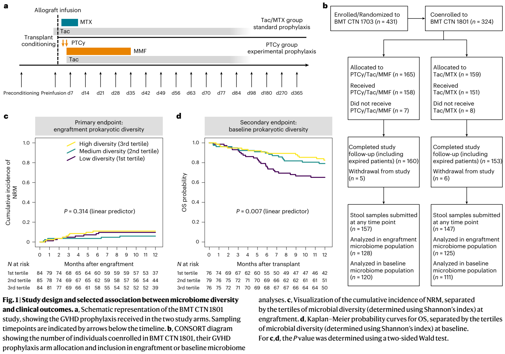

# 论文复现：GVHD 预防方案的肠道菌群随机 3 期试验（Nat Med 2026）

> 这是一篇「论文复现式」教程：论文官方分析仓库自带 7 个按执行顺序编排、逐脚本写明输入输出的 R 脚本，本文给出从数据获取到跑通分析的完整 VibeCoding 路径。**本教程全部命令为「未实测」档**——参与者级元数据尚在受控期（embargo），完整复现需先向 BMT CTN 数据访问委员会申请（见「常见坑」第 1 条）。

## 论文信息

| 项 | 内容 |
|---|---|
| 论文 | Wirbel J, Saber W, Martens MJ, et al. Effect of two common GVHD prophylaxis regimens on the gut microbiome in a randomized phase 3 trial. *Nat Med*. 2026;32:4234–4243. [doi:10.1038/s41591-026-04712-z](https://doi.org/10.1038/s41591-026-04712-z)（PMID 43020901，CC BY-NC-ND 4.0） |
| 分析代码 | https://github.com/jakob-wirbel/BMT_CTN_1801（**MIT 许可**） |
| 衍生数据 | Zenodo [10.5281/zenodo.22082235](https://doi.org/10.5281/zenodo.22082235)（论文 Code availability 引用版，CC BY-4.0，9 个文件：mOTUs/MetaPhlAn 物种表、HUMAnN 通路表、ddPCR、测序统计）；README 另链旧记录 [10.5281/zenodo.17127362](https://doi.org/10.5281/zenodo.17127362)（同一 Zenodo concept 的两个版本，数据文件相同、代码包更新过，引用以论文版为准） |
| 原始测序数据 | ENA [PRJEB97686](https://www.ebi.ac.uk/ena/browser/view/PRJEB97686)（无限制开放） |
| 研究体系 | BMT CTN 1801 菌群伴随研究：431 例 1703 期试验中 324 例共入组，304 例供便（Tac/MTX 147 / PTCy 157），2,575 份粪便宏基因组（mOTUs v3.0.3 + HUMAnN v3.9），30 家中心，NCT03959241 |

## 仓库评估（2026-11-20 实地核查，GitHub API + README + Zenodo API）

| 维度 | 评定 | 依据 |
|---|---|---|
| 代码完整度 | ✅ | 7 个分析脚本（`src/`，共约 17 万字节）+ `utils.r`；README 逐脚本写明**执行顺序、输入文件、输出目录**（论文复现仓库中少见的好习惯）；MIT LICENSE 文件在位 |
| 可执行性 | ⚠️ **未实测（受元数据 embargo 限制）** | 衍生数据（物种表/通路表/ddPCR/测序统计）Zenodo 可直下；但**样本/参与者元数据未公开**（README 自陈"not a full plug-and-play reproduction"），需向 BMT CTN Data Access Committee 申请；仓库未附依赖清单（R 包需从脚本推断） |
| 维护活跃度 | ⚠️ | 随论文的一次性仓库（创建 2025-06，最后推送 2026-08），无 release/issue |
| 许可与合规 | ✅ | 代码 **MIT**；Zenodo 数据 **CC BY-4.0**；论文本体 CC BY-NC-ND 4.0 |
| 仓库↔论文对应 | ✅ | README 引用论文预印本（bioRxiv 10.64898/2026.02.19.706769）；论文 p14 Code availability 明确指向本仓库 + Zenodo 22082235（该记录 related_identifiers 含同一预印本 DOI，双向印证） |

**结论：纳入**——代码完整度与许可俱佳；可执行性受元数据 embargo 限制，作为「数据获取 → 流程学习 → 部分复现」路径教程纳入，全量复现路径一并给出。

## 研究问题与核心发现

*Figure 1 · 研究设计、CONSORT 图与生存曲线（整图引自 Wirbel et al., Nat Med 2026, CC BY-NC-ND 4.0，仅作学术交流之用）*

菌群领域第一支在随机 3 期试验框架内采样的前瞻性研究：

1. **主要终点阴性**：植入时菌群多样性与 1 年非复发死亡率（NRM）无显著关联（P=0.314）——挑战"低多样性=差预后"的回顾性共识；
2. **基线 ≠ 植入时**：基线多样性最低三分位总生存更短（HR=0.47，P=0.031；线性 P=0.007）——"什么时间的菌群重要"比"菌群是否重要"更关键；
3. **方案特异性**：PTCy 组移植后多样性+绝对负载抑制更强（负载低约 2 倍，P=3×10⁻⁵）；C. scindens 与次级胆汁酸通路在 PTCy 组显著降低（唯一显著通路，q<0.01），且胆汁酸通路-慢性 GVHD 关联仅见于 Tac/MTX 组——菌群-胆汁酸-GVHD 轴在 PTCy 时代可能不再关键。

## 分析流程（论文做了哪些分析 ↔ 仓库哪个脚本）

| 分析环节 | 脚本（按 README 执行顺序） | 说明 |
|---|---|---|
| 绝对丰度预测 | `src/absolute_abundance_prediction.r` | DNA 浓度 ↔ 16S 拷贝数机器学习模型（ddPCR 双批次校准），详见配套方法论文 [10.1016/j.crmeth.2025.101030](https://doi.org/10.1016/j.crmeth.2025.101030) |
| 数据清洗合并 | `src/clean_tables.r` | 汇聚元数据+物种表+拷贝数 → `all_data.RData`（后续脚本统一输入）；含 same_day/next_day 处理质控对比 |
| 多样性轨迹 | `src/diversity.R` | 两臂 α 多样性+绝对负载随时间轨迹（论文 Fig 2） |
| 抗生素分析 | `src/abx_analyses.r` | 预防性 vs 非预防性抗生素暴露分层——证明两臂负载差不能归因抗生素 |
| 菌群统治 | `src/domination.r` | 单物种 >30% 优势事件（论文：~50% 样本 day 14 出现；统治物种不都是病原体） |
| 组成差异 | `src/composition.r` | 两臂相对丰度差异 + **C. scindens** 差异富集聚焦分析（论文 Fig 4a–c） |
| 功能通路 | `src/humann.R` | HUMAnN/MetaCyc 通路两臂差异 + **胆汁酸修饰通路**聚焦分析（论文 Fig 4d–f） |
| 临床终点统计 | ——（不在本仓库） | 主要/次要终点由 Biostatistics（Medical College of Wisconsin）按预设统计计划完成，官方结果见论文 Supplementary Information |

## 复现路径（VibeCoding，**全部未实测**）

> 元数据 embargo 下的现实策略：块 1–2 现在就能做；块 3–4 拿到元数据后补全。

### 块 1 · 环境搭建

> **提示词**：克隆 github.com/jakob-wirbel/BMT_CTN_1801 并扫描 src/ 全部 .r/.R 脚本中的 `library()`/`require()`/`::` 调用，生成完整 R 包依赖清单（仓库未提供）；随后制定安装方案（优先 conda-forge 二进制通道）并逐包验证。约束：不改仓库源码；依赖清单需注明每个包被哪个脚本引用。验收标准：清单覆盖全部脚本，`requireNamespace()` 逐包返回 TRUE。
>
> **校验点**：依赖清单文件存在且与脚本 grep 结果一致。

### 块 2 · 数据获取（现在即可完成）

> **提示词**：从 Zenodo 记录 10.5281/zenodo.22082235 下载全部 9 个文件到 data/ 目录（注意 humann.tsv 约 325 MB，建议断点续传），解压 motus_all.tsv.zip 与 BMT_CTN_1801.zip，逐一报告文件名、行数、列数。同时列出仓库 README 中各脚本的输入清单，标注哪些输入已在 data/ 就位、哪些缺失。验收标准：9 文件完整（核对 Zenodo 页面字节数），缺失输入有清单。
>
> **校验点**：`ls -la data/` 与 Zenodo 文件清单字节数一致；缺失输入清单含 meta_samples.tsv、meta_participants.tsv（元数据，DAC 申请）及 antibiotics_data.tsv（抗生素记录，来源待 DAC/申请件确认）。
>
> **已知坑**：BMT_CTN_1801.zip（约 46 KB）内容未逐一解包确认——`composition.r` 引用的 `files/mOTUs_3.0.0_GTDB_tax.tsv`、`files/abx_exposure.RData` 不在 Git 仓库 tree 内，可能在 zip 或需自行生成，先解包核实再下一步。

### 块 3 · 跑通分析（需元数据）

> **提示词**：向 BMT CTN Data Access Committee（论文 Data availability 节有指引）申请样本/参与者元数据获批后，按 README 顺序执行：clean_tables → diversity → abx_analyses → domination → composition → humann。约束：脚本输入输出路径若与本地布局不符，只建软链/复制到约定路径，不改脚本。验收标准：figures/ 下 alpha、abx、domination、composition、humann 五个子目录均有产物。
>
> **校验点**：`all_data.RData` 生成且 `load()` 后含 feat.motus、feat.metaphlan、df.meta.clean、df.response 四对象；五类图各至少一张。

### 块 4 · 结果对照

> **提示词**：将产出图与论文 Fig 2（多样性轨迹）、Fig 3（domination）、Fig 4（组成+胆汁酸通路）逐面板对照，输出三列覆盖表：论文面板 / 本地产物 / 一致性说明（方向一致 / 数值不同 / 无法复现——元数据受控或随机性）。另检查论文报的关键数字（day 14–28 Shannon P=0.038、Inverse Simpson P=0.011、负载约 2 倍差异 P=3×10⁻⁵）在本地统计输出中的对应值。验收标准：覆盖表完整，差异如实标注。
>
> **校验点**：对照表存在；数值差异条目均注明原因假设（样本处理批次/随机种子/软件版本），不臆断"复现成功"。

## 常见坑

1. **非 plug-and-play（README 自陈）**：参与者结局元数据仍在受控期，Zenodo 只有衍生组学表——完整复现必须先走 BMT CTN DAC 申请，这是本仓库与"下载即跑"类仓库的最大区别；
2. **humann.tsv 约 325 MB**：通路表是最大文件，低带宽环境建议只下 mOTUs/MetaPhlAn/ddPCR 先跑组成分析；
3. **两个 Zenodo DOI 并存**：README 链 17127362、论文引用 22082235（2026-08-24，同一 concept 的两个版本——数据文件相同、BMT_CTN_1801.zip 代码包更新过，related_identifiers 绑定预印本 DOI）——引用以论文版 22082235 为准；
4. **无依赖清单**：仓库未附 sessionInfo/DESCRIPTION，R 包依赖需从脚本推断（块 1 提示词已覆盖）；
5. **部分 files/ 输入不在 Git tree**：`composition.r` 的 `mOTUs_3.0.0_GTDB_tax.tsv`、`abx_exposure.RData` 未入 Git——先解包 BMT_CTN_1801.zip 核实，缺则按 mOTUs 官方文档生成注释文件。

## 版权与声明

- Figure 1 整图引自 Wirbel J, et al. *Nat Med* 2026（CC BY-NC-ND 4.0，仅作学术交流之用）；
- 分析代码 MIT License；Zenodo 衍生数据 CC BY-4.0；论文本体 CC BY-NC-ND 4.0。

> 本文内容以英文原文与工具官方文档为准；解读仅代表本号观点。
