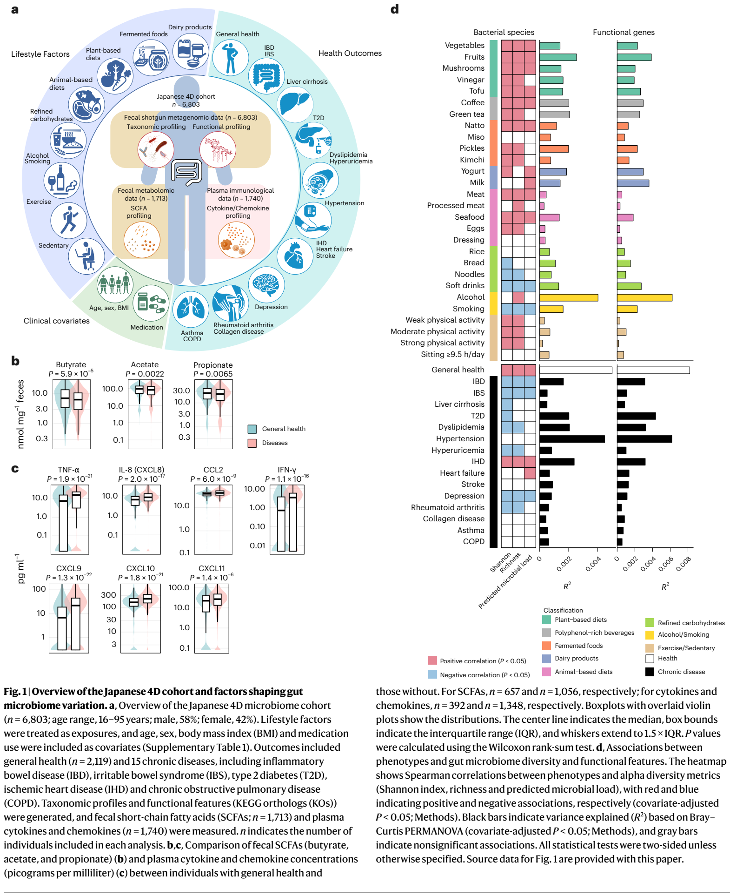

# 论文复现：生活方式—菌群—慢性病的两条介导轴（Nat Med 2026）

> 这是一篇「论文复现式」教程：论文官方分析仓库自带 64 个 R 文件（主图 1–6 + 扩展图 2–10 逐图脚本 + 13 个共享分析脚本），本文给出从数据获取到复现路径的完整 VibeCoding 指引。**本教程全部命令为「未实测」档**——队列个体级元数据因伦理不可公开，完整复现需等待 SRA 受控数据开放（见「常见坑」第 1 条）。

## 论文信息

| 项 | 内容 |
|---|---|
| 论文 | Nagata N, Wei R, Kaneko G, et al. Opposing microbiome-mediated axes link modifiable lifestyles to health and chronic diseases. *Nat Med*. 2026. [doi:10.1038/s41591-026-04744-5](https://doi.org/10.1038/s41591-026-04744-5)（PMID 42988934，CC BY-NC-ND 4.0） |
| 分析代码 | https://github.com/TheJP4DProject/Lifestyles_health_disease（LICENSE 文件实质 **MIT**，Copyright (c) 2026 Naoyoshi Nagata；文件首行非标准标题致 GitHub 显示 NOASSERTION） |
| 代码存档 | Zenodo [10.5281/zenodo.22932250](https://doi.org/10.5281/zenodo.22932250)（v1.0.0，论文 Code availability 引用；README 未提 Zenodo，以论文口径为准） |
| 数据 | 日本 4D 队列（6,803 成人）shotgun 宏基因组：SRA PRJNA1169537 (n=654) / PRJNA832909 (n=137) / PRJNA1445561 (n=1,082) 已公开；PRJNA1181123 (n=4,930) 于正式接收后开放。**个体级元数据（含疾病结局）不随 SRA 公开** |
| 研究体系 | 28 个可改变生活方式因素 × 综合健康 + 15 种慢性病（医师确诊）；SCFA（n=1,713）+ 血浆细胞因子（n=1,740）子集；纵向子集 402 人 804 样本（中位间隔 2.0 年） |

## 仓库评估（2026-11-20 实地核查：GitHub API + Zenodo API + 论文 PDF）

| 维度 | 评定 | 依据 |
|---|---|---|
| 代码完整度 | ✅ | 64 个文件、合计 433,033 字节，纯 R；README 7,827 字节含仓库结构/输入文件/系统要求（R≥4.3，MaAsLin2、lme4、glmnet 等 8 包）/运行/预期输出各节；覆盖论文主图 1–6 与扩展图 2–10 |
| 可执行性 | ⚠️ | **零示例数据**：共享脚本引用的输入（meta.atc.filter.csv、mo_7562samples_20250428.txt 等）均不在仓库；元数据受伦理限制不可公开；README 声明的输入名（metadata.csv/motu3_RA.xlsx）与脚本实际引用名不一致 |
| 维护活跃度 | ✅ | 创建 2026-04-26，最后 push 2026-09-27，100+ commits |
| 许可与合规 | ⚠️ | 实质 MIT 但 LICENSE 文件首行非标准（GitHub 无法自动识别）；人数据另有伦理限制（README 已声明） |
| 仓库↔论文对应 | ⚠️ | README 引用论文标题与作者（Nagata N, et al.），未见 DOI 字符串——对应关系依论文 Code availability 声明 + Zenodo 22932250（该记录为版本锁定锚点） |

**结论：条件纳入**——脚本与文档体量完整，但复现需自行获取受控元数据并逐脚本核对文件名；作为「数据获取 → 流程学习 → 复现路径」指引教程纳入。

## 研究问题与核心发现

*Figure 1 · 队列总览（整图引自 Nagata et al., Nat Med 2026, CC BY-NC-ND 4.0，仅作学术交流之用）*

1. **两条对立的介导轴**：健康导向中介物（n=187）呈丁酸相关抗炎构图；疾病导向中介物（n=175）富集口腔源菌与 pathobionts；
2. **健康轴**：植物基饮食经植物细胞壁多糖降解（果胶/半纤维素/纤维素 → 丁酰-CoA 发酵）介导；咖啡经 *Lawsonibacter asaccharolyticus* 介导 IBD 风险降低；
3. **疾病轴**：精制碳水经口腔源 *Streptococcus* + 淀粉降解/糖摄取/乳酸生成基因介导；吸烟与久坐同属此轴；
4. **起子菌 ≠ 健康网络**：纳豆/泡菜来源起子菌仅与 <10% 肠道物种相关；酸奶来源虽与 49.2% 相关却正相关炎症因子；
5. **MADE 评分**：LASSO 物种谱评分区分健康（AUC 0.789）与 15 种疾病，13 个非日本队列（n=3,095）重现。

## 分析流程（论文做了哪些分析 ↔ 仓库哪个脚本）

| 分析环节 | 脚本（README 组织） | 说明 |
|---|---|---|
| Fig 1 队列总览与多样性 | 逐图脚本（对应主图编号） | 28 因素 × 多样性指数关联（Shannon/丰富度/负载） |
| Fig 2 中介三元组 | 逐图脚本 + `AlphaIndex.R` | 正向中介 FDR<0.05 且反向 ≥0.05 的筛选 |
| Fig 3 中介物两轴构图 | 共享脚本 | 健康导向 n=187 vs 疾病导向 n=175 的 SCFA/细胞因子相关 |
| Fig 4 膳食功能通路 | `MaAsLin2.R` | 多糖降解 → 丁酰-CoA 的物种-基因双层中介 |
| Fig 5 起子菌检测 | 共享脚本 | 纳豆/泡菜/酸奶起子菌与菌群网络的关联强度 |
| Fig 6 MADE 评分 | `MADE score_LASSO.R` | LASSO 物种谱健康/疾病评分 + 外部队列验证 |
| 扩展图 2–10 | 逐图脚本 | SCFA/细胞因子佐证、纵向一致性等 |

## 复现路径（VibeCoding，**全部未实测**）

> 元数据伦理限制下的现实策略：块 1–2 现在就能做；块 3–4 需要受控数据。

### 块 1 · 环境搭建

> **提示词**：克隆 github.com/TheJP4DProject/Lifestyles_health_disease 并扫描全部 .R 脚本中的 `library()`/`require()` 调用，生成完整 R 包依赖清单（README 文字列出 MaAsLin2、lme4、glmnet 等 8 个，但仓库无 DESCRIPTION，请以脚本实测为准）。安装时优先 conda-forge 二进制通道。约束：不改仓库源码；清单需注明每个包被哪些脚本引用。验收标准：清单覆盖全部脚本，`requireNamespace()` 逐包 TRUE。
>
> **校验点**：依赖清单文件存在且与 `grep -E "library\\(|require\\(" src/*.R` 结果一致。

### 块 2 · 数据获取与文件名核对（现在即可做）

> **提示词**：对照 README 的输入清单（metadata.csv、motu3_RA.xlsx 等）逐一在仓库与 SRA 公开数据中核对可用性；把 README 输入名与脚本实际引用名（meta.atc.filter.csv、mo_7562samples_20250428.txt、RAdata_motu3_7562samples_newsp_20250629.xlsx、ko_7562samples_20250428.xlsx 等）整理成一张对照表，标记"仓库声明名 → 脚本实际名"的差异。验收标准：差异对照表完整，SRA 四个 BioProject 的公开样本量记录在案。
>
> **校验点**：对照表存在；公开数据量（654+137+1,082=1,873）与总队列 6,803 的差额有说明（4,930 待开放）。

### 块 3 · 元数据申请

> **提示词**：整理一封向 4D 队列数据访问委员会的申请邮件草稿（论文 Data availability 节有指引），说明研究目的、所需字段（物种表 + 28 生活方式因素 + 15 疾病结局 + 药物协变量）与分析计划要点。验收标准：草稿含具体字段清单与 Data availability 引用。
>
> **校验点**：草稿指向论文 p18 Data availability 的申请通道。

### 块 4 · 跑通分析（需元数据获批后）

> **提示词**：按 README 执行顺序运行逐图脚本（先 Fig 1b/c 多样性比较，再 Fig 2 中介分析，后 Fig 4 功能中介、Fig 6 MADE）。约束：脚本输入输出路径若与本地布局不符，只建软链/重命名数据文件到脚本约定名，不改源码。验收标准：至少 Fig 1–2 的输出图与论文方向一致（健康者 SCFA 高、炎症因子低）。
>
> **校验点**：`ls figures/` 输出非空；MaAsLin2 日志无 fatal error；与论文 Fig 1d 的正负方向抽查 5 个因素一致。

## 常见坑

1. **元数据不可公开（README 自陈）**：个体级疾病结局与生活方式记录受伦理限制——这是本仓库与"下载即跑"类仓库的根本区别；SRA 公开的 1,873 条 reads 缺配对元数据，跑不出论文结果；
2. **README 输入名 ≠ 脚本实际引用名**：块 2 的对照表是必做前置，否则逐图脚本会在读文件阶段全部报错；
3. **LICENSE 非标准首行**：GitHub 显示 NOASSERTION，实际为 MIT——引用与二次分发时按 MIT 条款执行即可，但建议在 fork 时附标准 MIT 文本；
4. **Zenodo 锁版本**：引用/复现时以论文引用的 22932250（v1.0.0）为准，仓库 main 分支后续提交可能与之不一致；
5. **部分脚本已参数化、部分仍是固定内部文件名**：Fig. 1B&C 用 `file.path(INPUT_DIR, ...)` 可直接改输入目录，其余脚本需逐一核对。

## 版权与声明

- Figure 1 整图引自 Nagata N, et al. *Nat Med* 2026（CC BY-NC-ND 4.0，仅作学术交流之用）；
- 分析代码 MIT License（LICENSE 文件非标首行，实质 MIT）；论文本体 CC BY-NC-ND 4.0；队列元数据另有伦理限制。

> 本文内容以英文原文与工具官方文档为准；解读仅代表本号观点。
