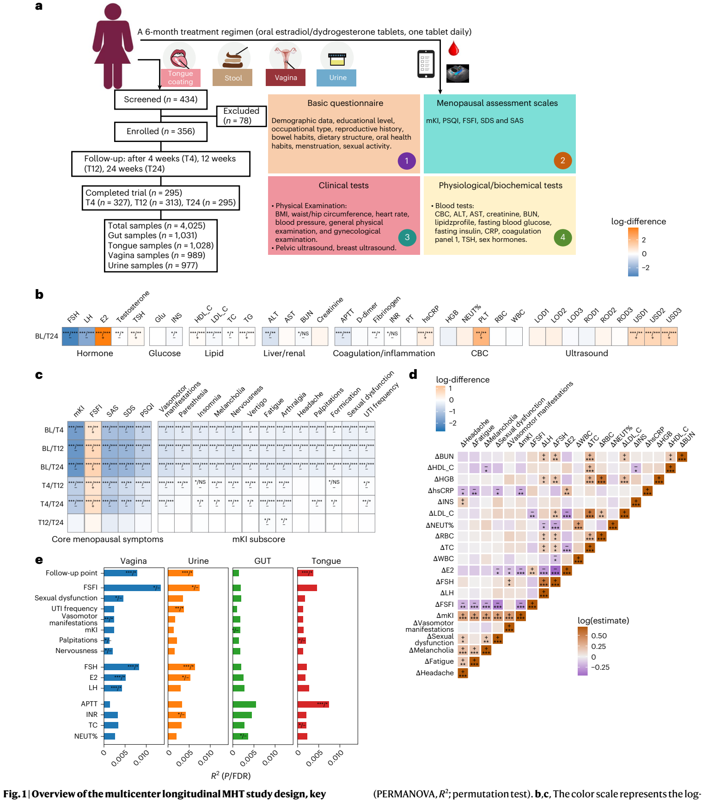

# 论文复现：MHT 激素治疗的多部位菌群响应异质性（Nat Med 2026）

> 这是一篇「论文复现式」教程：论文官方分析仓库自带 21 个 R 脚本 + 模拟数据集，本文记录从环境搭建到跑通代表性分析的真实过程，并给出用 AI 编程代理复现的完整路径。

## 论文信息

| 项 | 内容 |
|---|---|
| 论文 | Chen C, Hao L, Xie W, et al. Heterogeneity of microbiome responses to menopausal hormone therapy among perimenopausal women. *Nat Med*. 2026. [doi:10.1038/s41591-026-04737-4](https://doi.org/10.1038/s41591-026-04737-4)（PMID 42977757，CC BY-NC-ND 4.0） |
| 分析代码 | https://github.com/haolilan/MHT（**无 LICENSE 文件**——默认版权保留，使用前联系作者） |
| 数据 | CNSA CNP0005621（MHT 患者 4,025 样本）+ CNP0005953（健康成人 440），免登录下载；仓库自带**模拟数据** `data/MHT.demo.RData`（仅测试流水线用，非真实数据） |
| 研究体系 | 356 名围绝经期女性，口服雌二醇/地屈孕酮 6 个月，4 部位（阴道宫颈/尿液/舌面/粪便）× 4 时点（BL/T4/T12/T24）宏基因组测序（4,025 份样本），ChiCTR2100049768 |

## 仓库评估（2026-11-19 实地克隆并检查）

| 维度 | 评定 | 依据 |
|---|---|---|
| 代码完整度 | ⚠️ | 21 个 R 源脚本（6,652 行）+ MHT_Code_Figures.Rmd 流水线文档（304 行）+ 模拟数据 + README；**无 LICENSE 文件**（默认版权保留）；无 tests/CI；覆盖论文全部分析（CST 聚类/激素-代谢物相关/RF 分类/SEM 中介/多部位动态）但依赖真实数据才能产出论文级结果 |
| 可执行性 | ⚠️ **未实测跑通全流程** | 模拟数据可加载（18 个对象）；Rmd 引用预生成的 `Results/` 目录（需先运行 src/ 脚本）；**README 自陈模拟数据仅测试流水线执行**，产出论文级结果需 CNSA 真实数据 |
| 维护活跃度 | ⚠️ | 随论文发布的一次性仓库，无 release/issue |
| 许可与合规 | ⚠️ | **无 LICENSE 文件**——默认版权保留，学术使用前建议联系通讯作者（zhu_julie@vip.sina.com） |
| 仓库↔论文对应 | ✅ | README 引用论文预印本 DOI + 论文 p16 Code availability 明确指向本仓库 + README 末节含通讯作者信息 |

**结论：条件纳入**——可执行性受限于无 LICENSE + 模拟数据限制；但代码结构完整、覆盖论文全部分析，作为**流水线学习与复现路径参考**教程纳入。

## 研究问题与核心发现

*Figure 1 · 研究设计与临床结局全景（整图引自 Chen et al., Nat Med 2026, CC BY-NC-ND 4.0，仅作学术交流之用）*

MHT（激素治疗）的菌群效应并非"全肠一律"。356 人多部位纵向研究揭示：

1. **位点异质性**：阴道宫颈+尿液重塑最显著、口腔中度、肠道最小——激素治疗的菌群效应有明确的解剖位点选择性；
2. **基线分型预测响应**：肠道 P. vulgatus 主导者 72.1% 达激素响应 vs P. copri 主导者 52.2%（P=0.010，OR=2.37）；阴道宫颈 L. crispatus 基线高者 FSFI 改善更大；
3. **精准 MHT 框架**：整合肠道+阴道宫颈群落分型可构建个体化激素治疗方案决策。

## 分析流程（论文做了哪些分析 ↔ 仓库哪个脚本）

| 分析环节 | 脚本 | 说明 |
|---|---|---|
| CST 聚类 | `Overall.Evaluation.CST_Clustering.R` / `Overall.Evaluation.CST.R` | 阴道宫颈/尿液/肠道/舌面四部分群落分型 |
| 群落结构 | `Overall.Evaluation.CST_bray.R` | Bray-Curtis 距离 + PCoA |
| 多样性 | `Overall.Evaluation.VA_Ref_UR_Diversity.R` | Shannon/Pielou 多样性 |
| 激素-代谢物热图 | `Correlation_clinic.R` | 临床指标 × BL/T24 差异热图 |
| RF 分类器 | `RF_classifer_MergeROC.R` / `RF_classifer_simplified_revised_0715.R` | 随机森林基线菌群预测激素响应 |
| 肠道分型-响应 | `Responser.Evaluation.Cross_GUTtype.R` | GUT-P.v vs GUT-P.cop 响应率 |
| SEM 中介 | `Mediation_FSFI_Vagina.R` | L. crispatus → FSFI 中介效应 |
| PERMANOVA | `Permanova.R` | 群落结构置换检验 |
| 汇总流水线 | `MHT_Code_Figures.Rmd` | 串联全部结果并展示 |

## 复现路径（VibeCoding）

### 块 1 · 环境搭建

> **提示词**：帮我安装 MHT 仓库所需的 R 环境（github.com/haolilan/MHT）。依赖包包括 missForest、tidyverse、ComplexHeatmap、lavaan、ggpubr、circlize、patchwork、broom、janitor。约束：不要改仓库源码；装完用 `library()` 逐包验证。验收标准：全部包加载无报错。
>
> **校验点**：`sapply(c("missForest","tidyverse","ComplexHeatmap","lavaan","ggpubr"), requireNamespace, quietly=TRUE)` 全 TRUE。
>
> **已知坑**：tidyverse 在 conda 版 R 上从源码装会在 xml2 阶段报 `cannot find -lxml2`，改用 `conda install -c conda-forge r-tidyverse` 走二进制包。

### 块 2 · 数据加载

> **提示词**：仓库自带 `data/MHT.demo.RData` 模拟数据（README 声明仅用于测试流水线执行，非真实数据）。请加载并报告全部对象的类型与维度。验收：成功加载 18 个对象，含 `Phen.Delta`（1,974×55）、`phen.enroll`（329×146）、`Phen.Seq`（1,316×57）等。
>
> **校验点**：`load("data/MHT.demo.RData")` 后 `ls()` 输出 18 个对象。

### 块 3 · 跑通分析

> **提示词**：使用模拟数据跑通 src/ 目录下的核心脚本（按依赖顺序）：CST 聚类 → 激素-代谢物热图 → RF 分类 → SEM 中介。注意脚本可能需要修改工作目录或输出路径（仓库未硬编码但需确认）。验收：至少一个脚本产生 `Results/` 目录下的输出文件。
>
> **校验点**：`ls Results/` 非空；MHT_Code_Figures.Rmd 引用的结果文件路径在 `Results/` 下可找到。

### 块 4 · 结果对照

> **提示词**：仓库 README 明确声明模拟数据仅测试流水线执行、不反映真实研究结果。请确认产出与论文 Fig 1–5 的哪些面板**可以**在模拟数据下复现流程逻辑（即使数值不同），哪些**不能**（因缺少真实测序数据或临床信息）。输出覆盖范围清单。
>
> **校验点**：对照表含论文主图编号、仓库脚本、模拟数据可否复现三列。

## 常见坑

1. **无 LICENSE 文件**：仓库未附许可协议——默认版权保留。学术使用前建议联系通讯作者（zhu_julie@vip.sina.com）；
2. **模拟数据 ≠ 真实数据**：`MHT.demo.RData` 是伪数据（含随机噪声），产出数值与论文不一致属正常；真实数据需从 CNSA 下载（免登录）；
3. **Rmd 引用预生成结果**：`MHT_Code_Figures.Rmd` 是展示文档，引用 `Results/` 目录——需先运行 `src/` 脚本产出结果再渲染 Rmd；
4. **tidyverse 编译坑**：conda 版 R 上从源码装 tidyverse 报 `-lxml2` 缺失，改用 conda 二进制通道。

## 版权与声明

- Figure 1 整图引自 Chen C, et al. *Nat Med* 2026（CC BY-NC-ND 4.0，仅作学术交流之用）；
- MHT 仓库**无 LICENSE**——默认版权保留，学术复现请联系通讯作者；论文本体 CC BY-NC-ND 4.0。

> 本文内容以英文原文与工具官方文档为准；解读仅代表本号观点。
