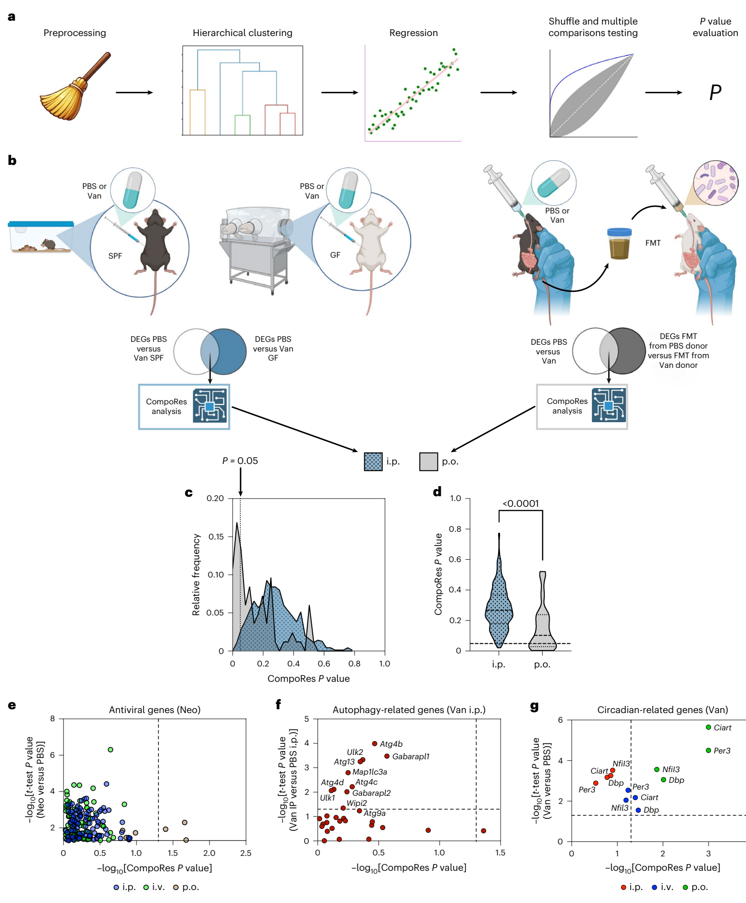

# CompoRes：判断"宿主响应是否依赖菌群组成"的组合数据分析工具

## 工具信息

| 项 | 内容 |
|---|---|
| 名称 | CompoRes（Compositional Response 分析，v0.3.0） |
| 源码 | https://github.com/AmirErez/CompoRes |
| 论文 | Zelik L, Levin Y, Sawaed J, et al. *Nat Microbiol*. 2026. [doi:10.1038/s41564-026-02453-w](https://doi.org/10.1038/s41564-026-02453-w)（本文为其方法学核心） |
| 输入 / 输出 | 样本×分类群 TSV + 样本×响应 TSV + YAML 配置（可选样本分组）→ HTML 报告（响应排名、观测 vs 置换对照图、最优 log-ratio、分类群相关性聚类热图） |
| 资源需求 | Python ≥3.10（官方 conda 锁 3.12）；无数据库依赖；quick demo 官方口径约 75 秒/18 核 Mac（本机多核实测 35 秒），full demo 官方口径 11–13 分钟 |
| 平台 | Linux（glibc 2.28+）/ macOS（Intel、Apple Silicon） |

## 仓库评估（2026-10-28 实地核验并实测）

| 维度 | 评定 | 依据 |
|---|---|---|
| 代码完整度 | ✅ | src/ 源码 + tests/（pytest 全套）+ configs/ 示例配置 + docs/（tutorial、reference）+ CHANGELOG + GitHub Actions 检查徽章；发布 release 0.3.0 |
| 可执行性 | ✅ **实测通过** | 官方双通道（conda env / pip editable）；quick demo 端到端跑通（见下表实测记录） |
| 维护活跃度 | ⚠️ | 随论文发布的学术工具，版本节奏以论文为准；有 CHANGELOG 与语义化版本 |
| 许可与合规 | ⚠️ | **SOFTWARE RESEARCH LICENSE**（Yissum，希伯来大学技术转移公司）：研究、教学、评估用途明确允许，**禁止任何直接/间接商用**——商业集成前需联系 Yissum 另行授权 |
| 仓库↔论文对应 | ✅ | CompoRes README 未直接引用论文；对应证据为原文 p14 Code availability 节给出该仓库 URL（Zelik et al. 2026） |

**结论：达标纳入**（完整度 ✅ + 可执行性 ✅）。许可限制如实标注：科研使用无障碍。

### 实测记录（2026-10-28，Python 3.10.12 + pip editable 安装）

| 环节 | 结果 |
|---|---|
| 安装 | ✅ `pip install -e .`（venv 内，依赖 numpy≥2 / pandas / scipy / matplotlib≥3.10 / scikit-learn / statsmodels / seaborn / pyyaml / numba / fastparquet 全自动解析）；CLI `compores -h` 正常 |
| quick demo | ✅ `compores --config configs/config_synthetic_data_quick.yaml`，50 分类群 × 100 样本 × 10 响应 × 10 OCU 层级 × 10 置换/层，**35 秒跑完**（多核并行，user 时间 2m51s） |
| 行为验证 | ✅ 官方设计是"5 个植入关联响应 + 5 个噪声响应"：最终排名产物（`artificial_experiment_output_quick/compores_response_ranking/…/pairs/…cycle_2.csv`，report.html 同源）中植入响应 gev 分 13.47–19.87、bootstrap 分 2.40，噪声响应 gev 0.09–4.84、bootstrap 0.06–1.46——**5 个植入响应全部排在 5 个噪声响应之上**（CLR 法与两轮 cycle 一致），与 README 预期相符。注：shuffle 无随机种子，逐次运行数值不同（官方口径），排序结论稳定 |
| 产物结构 | ✅ `artificial_experiment_output_quick/`：report.html + balance_calculation_results / compores_basic_results / compores_response_ranking / logs / plots / preprocessed_samples / preprocessing_results 共 7 个子目录 |
| full demo | ⏭️ 未跑（官方口径 11–13 分钟；quick demo 已覆盖全流程逻辑） |
| conda 通道 | ⏭️ 未走（pip 通道已实测通过；官方 conda env 锁 Python 3.12，pip 依赖声明 ≥3.10，实测 3.10 可用） |

## 工具概述：它解决什么问题

"菌群组成变化"与"宿主响应变化"同时出现时，怎么判断这个响应是真跟菌群走，还是与随机无异？两条拦路虎：微生物组数据是**组成数据**（绝对丰度不可观测，普通相关会出假信号），以及**多重检验**（海量分类群 × 海量响应基因）。

CompoRes 的答案：把相关分类群聚成操作聚类单元（OCU），在多个聚类层级上搜索与响应关联最强的 log-ratio（对数比），再与**置换打乱后的数据**比一比——如果最强关联与随机打分没有本质差别，这个响应就判为"菌群非依赖"。适用面不限于抗生素：任何"组成型数据（菌群/代谢组）× 表型响应"的解耦问题都能套用。

需要注意它给的是**相对丰度模式下的关联**，不建立因果，也不推断绝对丰度变化（README 原文口径）。

## 算法实现

*Figure 3 · CompoRes 流程（OCU 聚类 → log-ratio 搜索 → 置换对照）及其对万古霉素昼夜基因表达的"菌群非依赖"判定（整图引自 Zelik et al., Nat Microbiol 2026, CC BY-NC-ND 4.0，仅作学术交流之用）*

1. **预处理**：样本×分类群表过滤与标准化（CLR 变换体系）；
2. **OCU 聚类**：按分类群相关性做层级聚类，得到多分辨率"操作聚类单元"；
3. **log-ratio 搜索**：在若干聚类层级上，为每个响应变量搜索关联最强的"聚类内 vs 聚类外"对数比；
4. **置换对照**：对样本标签做置换打分，将观测到的最强关联与置换分布比较，得到响应级别的 CompoRes P 值与排名；
5. **报告**：HTML 报告汇总响应排名、观测 vs 置换图、最优 balances，可选分类群溯源与分类功效分析。

在论文中它承担关键判断：系统给药万古霉素对结肠昼夜基因表达的破坏与菌群组成解耦（"菌群非依赖"），并在仿真数据与"已知仅直接作用于宿主"的实验数据上完成验证（Extended Data Fig. 4c–e，AUROC 表现高）。

## VibeCoding 实战提示词

以下提示词面向 AI 编程代理（Claude Code / ZCode / Cursor 等），目标是让代理帮你在**官方仓库**基础上完成部署与分析，不硬编码命令。

### 块 1 · 安装

> **提示词**：帮我安装 CompoRes（github.com/AmirErez/CompoRes，release 0.3.0）。优先按官方 README 的 conda 方案（env/compores_env.yml）；如果本机没有 conda，用 Python ≥3.10 的虚拟环境走 `pip install -e .`。约束：不要改源码；装完用 `compores -h` 验证。验收标准：帮助信息正常打印，且 `pip show compores` 显示 0.3.0。
>
> **期望产出**：可用的 `compores` 命令行入口。
> **校验点**：`compores -h` 退出码 0；`python -c "import compores"` 不报错。

### 块 2 · 数据准备

> **提示词**：我要用 CompoRes 分析自己的菌群-响应数据。请按官方 README 的输入规范准备两个 TSV（样本×分类群计数表、样本×响应表）与一份 YAML 配置：从仓库 `configs/config.yaml` 复制后改路径。注意 README 强调的两个格式细节——文件用真实制表符；两表首列表头为空、样本 ID 完全对应。请先给我的数据写一个格式自检脚本（列对齐、全 tab、无重复样本 ID），自检通过再生成配置。
>
> **期望产出**：两个通过自检的 TSV + 一份指向它们的 YAML。
> **校验点**：自检脚本输出全绿；YAML 中的路径绝对且存在。

### 块 3 · 运行

> **提示词**：先跑通官方 quick demo（configs/config_synthetic_data_quick.yaml）确认环境没问题，然后跑我的配置。约束：显式 `--config` 传参（0.3.0 起裸 `compores` 只打印帮助）；先跑 `--preprocess` 看分类群聚类热图，再跑全流程。运行完告诉我 report.html 的绝对路径。
>
> **期望产出**：`artificial_experiment_output_quick/report.html` + 自己数据的结果目录与 report.html。
> **校验点**：quick demo 中 5 个 planted（correlated）响应排名应高于 5 个 noise 响应——这是官方内置的正确性烟囱测试；自己数据的报告能列出全部响应的排名。

### 块 4 · 结果解读

> **提示词**：阅读我数据生成的 report.html 与 `compores_response_ranking` 结果表，解释：哪些响应的观测关联显著高于置换分布（菌群依赖候选），哪些与随机无异（菌群非依赖候选）；对每个重点响应给出其最优 log-ratio 由哪些分类群构成。提醒我该结论的边界（相对丰度关联、非因果）。
>
> **期望产出**：响应分级清单 + 分类群构成说明 + 边界提示。
> **校验点**：解释中的分数/排名与 report.html 原始数值一致（抽查 3 个）。

## 常见坑

1. **TSV 首列表头必须为空且用真实 tab**（官方反复强调，空格/逗号会静默错位）——实测建议先过自检脚本；
2. **demo 资产只在仓库内**：合成数据 demo 需要 clone 仓库并 editable 安装（`pip install -e .`），纯 wheel 安装不含 demo 资产；
3. **CLI 行为自 0.3.0 改变**：裸 `compores` 现在只打印帮助（旧版直接跑 demo），务必显式 `--demo` 或 `--config`；
4. **Python 版本弹性**：官方 conda 锁 3.12，但依赖声明 ≥3.10——实测 3.10.12 + pip 通道可用；遇到 numba/fastparquet 编译问题优先回官方 conda 通道；
5. **许可边界**：SOFTWARE RESEARCH LICENSE 允许科研/教学/评估，**排除商用**；商业场景需向 Yissum 取得授权。

## 版权与声明

- Figure 3 整图引自 Zelik L, Levin Y, Sawaed J, et al. *Nat Microbiol*. 2026（CC BY-NC-ND 4.0，仅作学术交流之用；截取自原文图版页，图版像素未作改动）；
- CompoRes 源码遵循其 SOFTWARE RESEARCH LICENSE（以仓库 LICENSE 文件为准）。

> 本文内容以英文原文与工具官方文档为准；解读仅代表本号观点。
