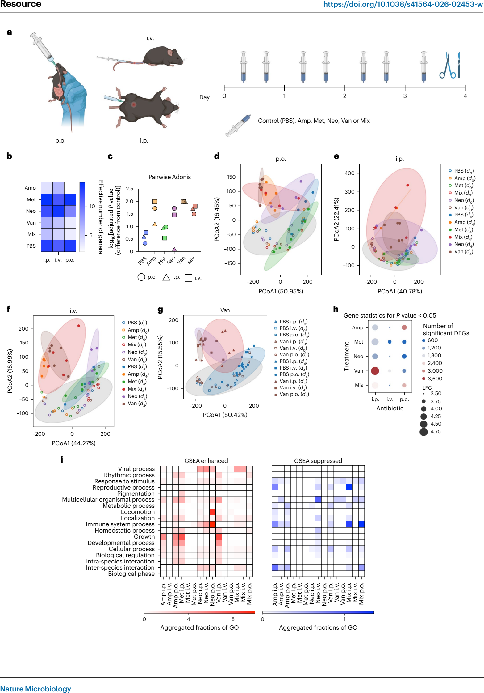

# 论文复现：抗生素对宿主生理的菌群依赖 / 独立效应拆解（Nat Microbiol 2026）

> 这是一篇"论文复现式"教程：论文官方分析仓库自带全套中间数据与脚本，本文记录从环境搭建到跑通代表性分析的真实过程，并给出用 AI 编程代理复现的完整路径。

## 论文信息

| 项 | 内容 |
|---|---|
| 论文 | Zelik L, Levin Y, Sawaed J, et al. Disentangling microbiota-dependent and -independent impacts of antibiotics on host physiology. *Nat Microbiol*. 2026. [doi:10.1038/s41564-026-02453-w](https://doi.org/10.1038/s41564-026-02453-w)（PMID 42897202，Resource） |
| 分析代码 | https://github.com/AmirErez/Manuscript-Analysis-of-Host-and-Microbiome-Responses-to-Antibiotics（**MIT**，ErezLab） |
| 方法学工具 | CompoRes（同组出品，见本目录 [composres.md](composres.md)） |
| 数据 | 仓库自带 `Data/`（纯仓库内容约 133 MB 中间数据：转录组、OTU 表、GSEA、GO 聚类属性等；含运行输出后 du 约 138 MB）；原始数据 GEO 超级系列 GSE293364 / GSE293029，BioProject PRJNA1442090，PC12 RNA-seq GSE324684 |
| 研究体系 | 小鼠（SPF + 无菌）× 4 抗生素 × 口服/腹腔/静脉三途径 + 体外神经元；16S / 宏基因组 / 结肠转录组 / 昼夜时序 |

## 仓库评估（2026-10-28 实地核验并实测）

| 维度 | 评定 | 依据 |
|---|---|---|
| 代码完整度 | ✅ | 16 个 Python 分析脚本 + 4 个 R 脚本 + `Data/` 133 MB 中间数据（转录组、OTU 表、GSEA、AUROC、GO 聚类属性全带）+ README 逐脚本用法说明 + init_project.py 初始化器 |
| 可执行性 | ✅ **实测通过** | 官方 requirements.txt 锁定版本全量安装 + init_project + `rat_neurons.py` 全流程跑通（见下表） |
| 维护活跃度 | ⚠️ | 随论文发布的一次性仓库，无 CI/release——学术复现仓库常态 |
| 许可与合规 | ✅ | MIT License（Copyright 2025 ErezLab） |
| 仓库↔论文对应 | ✅ | README 开篇即声明服务于论文 "Analysis of Host and Microbiome Responses to Antibiotics"，脚本与论文图一一对应 |

### 实测记录（2026-10-28，conda Python 3.12 + 官方锁定依赖）

| 环节 | 结果 |
|---|---|
| 环境 | ✅ `requirements.txt` 锁定版本全量装齐：numpy 2.2.6 / pandas 3.0.0 / matplotlib 3.9.2 / scikit-learn 1.5.1 / pydeseq2 0.5.4 / goatools / gseapy 等（注意 pandas 3.0.0 要求 Python ≥3.11，Python 3.10 装不上锁定版） |
| 初始化 | ✅ `python init_project.py` 创建 `Private/` 全套输出目录结构 |
| 代表性分析 | ✅ `rat_neurons.py` 全流程 51 秒：数据加载清洗 → z-score 变换 → **pydeseq2 差异分析（13,353 个大鼠基因）** → 核糖体驱动分析；产出 `DESeq2_results.csv`、`driver_results.tsv` 与 4 张 PDF 图（热图/评分/散点/气泡图） |
| CompoRes 衔接 | ✅（另册实测）CompoRes 本体安装与 demo 见 [composres.md](composres.md)；衔接关系经源码核读：`compores_results_analysis.py` 与 `diablo_vs_compores.py` 顶部有 `COMPORES_PATH` 变量（读 CompoRes 输出），`pairs_compores.py` 无该变量——它是 CompoRes **输入生成器**（读 `Data/Pairs`，写 `Private/CompoResGenes/`） |
| R 脚本 | ⏭️ 未实测：ANCOM-BC / DIABLO / PERMANOVA 需另装 CRAN + Bioconductor 包（vegan、compositions、ANCOMBC、phyloseq、mixOmics） |
| 其余 Python 脚本 | ⏭️ 未逐一实测：`microbiome_pca.py` 等部分脚本引用仓库外相对路径（`../Data/MultiAbx-16s/`），需自备对应原始数据（见常见坑 3） |

## 研究问题与核心发现

*Figure 1 · 实验设计与菌群/宿主响应全景（整图引自 Zelik et al., Nat Microbiol 2026, CC BY-NC-ND 4.0，仅作学术交流之用）*

抗生素影响宿主健康，教科书式解释是"改变肠道菌群→菌群影响免疫代谢"。本研究用"四抗生素 × 三途径 × 有菌/无菌"矩阵把这条假设拆开检验，三个核心发现：

1. **给药途径本身就是变量**：腹腔注射的万古霉素竟能到达肠腔并改变菌群组成（大分子亲水化合物，教科书预期不跨黏膜；质谱证实）；口服使 Enterobacteriaceae 增（P=0.0002），系统给药使 Tannerellaceae 增（P=0.002）——同药不同途径，菌群后果完全不同；
2. **菌群非依赖的直接效应**：系统给药万古霉素对结肠昼夜基因表达的破坏，经 CompoRes 判定与菌群组成解耦；无菌鼠实验同样复现；
3. **机制链**：万古霉素 → 肠神经表达 NMU/NMUR2 → 进食减少 → 葡萄糖驱动的 MHC-II 与脂代谢基因昼夜节律错位（Nmu 敲除鼠 + PC12 体外验证，通路在果蝇脑中保守）。

## 分析流程（原文的生信步骤 ↔ 仓库脚本）

| 分析环节 | 脚本 | 说明 |
|---|---|---|
| 差异表达 | `DE_expression.py`、`rat_neurons.py` | pydeseq2 差异分析（主体队列 + 体外神经元） |
| GO 聚类 | `ClusteringGO.py` | goatools 驱动的基因 GO 注释聚类 |
| 时序分析 | `time_points.py` | SPF/GF 昼夜时序基因表达 |
| 机器学习 | `random_forests.py`、`pairs_RF.py` | 随机森林按抗生素×途径分类宿主响应 |
| 菌群组成 | `ANCOM_clean.R`、`PERMANOVA_single_groups_transformations.R`、`microbiome_pca.py`、`pcoa_referee.py` | ANCOM-BC 差异丰度、PCoA/PERMANOVA 多变换对照 |
| 测序平台互验 | `metagenomics_16s_comparison.py` | 宏基因组 vs 16S 一致性 |
| **CompoRes 解耦** | `pairs_compores.py`、`compores_results_analysis.py`、`diablo_vs_compores.py` | 核心方法学；`pairs_compores.py` 生成 CompoRes 输入（读 `Data/Pairs`，写 `Private/CompoResGenes/`），另两脚本读 CompoRes 输出（顶部 `COMPORES_PATH` 指向结果目录） |
| 多组学整合 | `DIABLO.R`、`DIABLO_pairs.R` | mixOmics DIABLO 与 CompoRes 结果对照 |
| 汇总绘图 | `all_figures_plot.py`、`clusters_plot.py` | 论文主图汇总 |

## 复现路径（VibeCoding）

### 块 1 · 数据获取

> **提示词**：克隆官方仓库（github.com/AmirErez/Manuscript-Analysis-of-Host-and-Microbiome-Responses-to-Antibiotics），确认 `Data/` 目录存在且约 133 MB。我之后想追原始测序数据，请整理一份下载清单：GEO 超级系列 GSE293364 及子系列 GSE293029、BioProject PRJNA1442090、GSE324684（PC12），注明各 accession 对应论文里的哪部分数据。验收：仓库内 README 提到的关键输入文件（transcriptome_2023-09-17-genes_norm_named.tsv、otu_merged_feces_genus_qiime_d0.tsv、metadata.xlsx）逐一存在。
>
> **校验点**：`ls Data/` 与 README 结构图对得上；三份关键文件字节数非零。

### 块 2 · 环境搭建

> **提示词**：按仓库 requirements.txt 建环境。注意 pandas==3.0.0 要求 Python ≥3.11——请用 Python 3.12（conda 或 venv 均可，PyPI 走国内镜像时加 `-i` 镜像源）。装完跑 `python init_project.py` 创建 Private/ 输出目录。不要改动仓库源码。验收：依赖导入零报错 + Private/ 目录树生成。
>
> **校验点**：`python -c "import numpy, pandas, pydeseq2, goatools, gseapy"` 通过；`Private/analysis` 等目录存在。

### 块 3 · 跑通分析

> **提示词**：先跑自包含的 `rat_neurons.py`（数据全在 `Data/rat_neurons/`）。注意已知坑：脚本内路径拼写是 `Data/rat_nuerons`（少一个 e），与实际目录名不符——用软链接 `ln -s rat_neurons Data/rat_nuerons` 绕过，不要改源码。跑通后按同样方式试 `random_forests.py` 与 `DE_expression.py`，输出落在 Private/ 与 Data/ 内即算成功。验收：rat_neurons 产出 DESeq2_results.csv + 4 张 PDF 图。
>
> **校验点**：`Data/rat_neurons/Analysis_Results/` 下出现 DESeq2_results.csv、driver_results.tsv、plot1–4 PDF；DESeq2 结果行数 ≈ 1.3 万基因量级。

### 块 4 · 结果对照原文

> **提示词**：仓库 `Data/GSEA/`、`Data/auroc/`、`Data/clusters_properties/` 带有论文的预计算结果。请把我在块 3 复算出的关键量与这些预计算值对照（列表：指标 / 我的复算值 / 仓库预计算值 / 是否一致），并对照论文 Figure 1–5 与 Extended Data 的对应关系说明每个脚本产出支撑哪张图。差异超过合理范围（如随机种子导致的 GSEA 排名微差）时如实标注。
>
> **校验点**：对照表覆盖至少 3 个关键指标；差异项均有解释或标记"待查"。

### 块 5 · CompoRes 全链路（进阶）

> **提示词**：安装 CompoRes（见 composres.md 块 1），先用 `pairs_compores.py` 从 `Data/Pairs` 生成 CompoRes 输入（输出落在 `Private/CompoResGenes/`），对生成的输入跑 CompoRes，再把 `compores_results_analysis.py` 顶部的 `COMPORES_PATH` 指向 CompoRes 结果目录，复现论文的"菌群非依赖"判定流程。验收：CompoRes report.html 生成 + `compores_results_analysis.py` 跑通。
>
> **校验点**：report.html 中响应排名表非空；`Private/CompoResGenes/` 下有生成的输入文件。

## 常见坑

1. **目录名拼写坑（实测踩过）**：`rat_neurons.py` 写的是 `Data/rat_nuerons`，实际目录是 `Data/rat_neurons`——软链接绕过最稳；
2. **Python 版本下限（实测踩过）**：官方锁定 pandas==3.0.0 要求 Python ≥3.11，Python 3.10 环境直接安装失败；用 3.12；
3. **部分脚本依赖仓库外路径**：如 `microbiome_pca.py` 读 `../Data/MultiAbx-16s/`，这部分对应未随仓库分发的原始数据，需从 GEO 自行下载补齐；
4. **R 脚本另起炉灶**：ANCOM-BC / DIABLO / PERMANOVA 走 CRAN + Bioconductor（vegan、compositions、ANCOMBC、phyloseq、mixOmics），与 Python 环境互不覆盖；
5. **`COMPORES_PATH` 要手设**：`compores_results_analysis.py` 与 `diablo_vs_compores.py` 顶部硬编码该变量指向 CompoRes 结果目录，换机器必改；注意 `pairs_compores.py` 没有这个变量——它是输入生成器（写 `Private/CompoResGenes/`）；
6. **init_project 必须先跑**：脚本们直接往 `Private/` 子目录写输出，目录不存在会报错。

## 版权与声明

- Figure 1 整图引自 Zelik L, Levin Y, Sawaed J, et al. *Nat Microbiol*. 2026（CC BY-NC-ND 4.0，仅作学术交流之用；截取自原文图版页，仅去除页边距，图版像素未作改动）；
- 分析代码仓库为 MIT License；CompoRes 为 SOFTWARE RESEARCH LICENSE（研究用途，禁商用）。

> 本文内容以英文原文与工具官方文档为准；解读仅代表本号观点。
