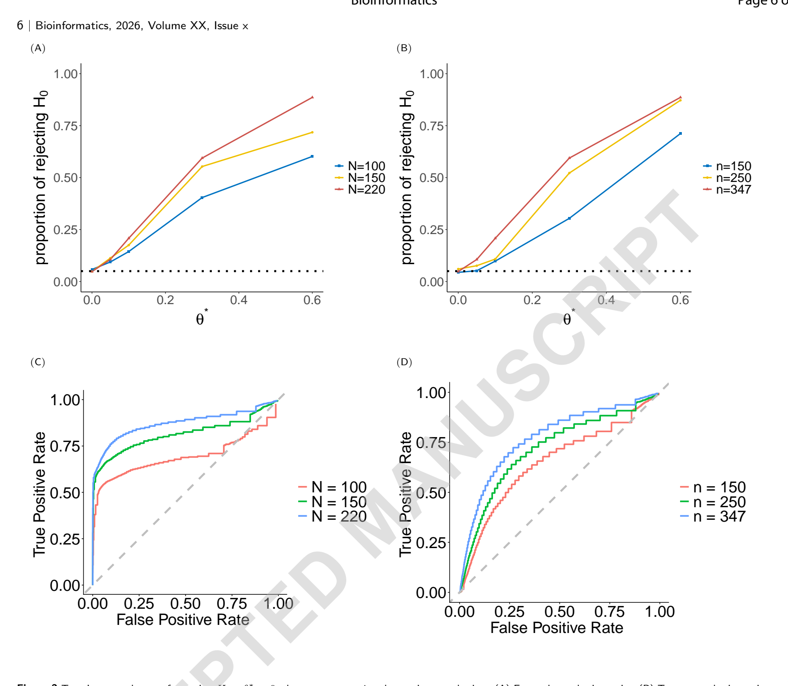

# predmetab：只有菌群数据没有代谢组？两套队列这样"拼"出通路

> 微生物组-代谢组-疾病通路推断 R 包 ｜ Bioinformatics · 2026 ｜ [论文原文](https://doi.org/10.1093/bioinformatics/btag787) ｜ [工具源码](https://github.com/lei-fang-stat/MMDP)
>
> 本文首发于微信公众号「肠动心弦」。

---

**Bioinformatics · 2026 · Advance Article · 方法与软件（互补数据集整合 + 高维结构方程模型）**

> **导读**：想做"肠道菌 → 代谢物 → 疾病"的通路分析，最尴尬的莫过于：手上最大的临床队列只有菌群和结局数据、没测代谢组；而测了菌群-代谢组配对的多组学研究又样本小、表型窄。这篇刚上线的 Bioinformatics 论文给了一个统计上的"拼图"方案——用小队列训练"菌群预测代谢物"的模型，回填大队列再做通路推断，R 包 predmetab 开源可直接上手。

## 研究背景：通路分析的最大障碍是"数据残缺"

微生物组-代谢组-疾病的三角关系是理解"菌群如何影响健康"的核心路径，但现实中几乎没有一份"理想数据集"能同时满足大样本、菌群+代谢组配对、有临床结局三个条件。代谢组平台之间的差异（靶向/非靶向、检测技术、代谢物覆盖面）让不同研究测到的分子清单都对不齐，通路重建更是难上加难。

整合互补数据集是显而易见的出路，但带来三个统计难题：**跨数据集的代谢物缺失怎么补**、**菌群特征的高维性怎么压**、**菌群数据的组成性（百分比此消彼长）怎么处理**——尤其最后一个：主流的对数比（ALR）分析结果依赖"参照菌"选谁，换个参照，结论可能就变了。

近日，迈阿密大学、肯塔基大学与科罗拉多大学 Anschutz 医学院的统计团队在 Bioinformatics 发表方法论文，给出了一个系统性的解法。

## 方法速览：一套"大队列 × 小队列"的拼接语法

框架把两类数据各就各位：**目标数据**=大队列（菌群 + 疾病结局，缺代谢物），**外部数据**=小研究（菌群 + 代谢组配对）。核心假设与流程分三层：**① 高维结构方程模型（SEM）**：把"菌→代谢物""代谢物+菌→结局"写成联立方程，允许未测混杂（比如饮食）同时影响代谢与结局；**② 借刀补缺**：第一阶段在外部数据上用 Lasso 训练"菌群→代谢物"预测模型，回填大队列里缺失的代谢物；第二阶段把它代入结局方程、同时调整菌群混杂，估计代谢物对结局的直接效应；**③ 显著性检验**：正则化置换检验，专门适配高维场景。

模型还会给每个菌自动"定性"，归入四种功能角色：既推动代谢物又直接影响结局的"双面手"、只通过代谢物起效的"中介通道"、绕开代谢物直接作用于结局的"直通线"，以及与该通路无关的菌。

### 关键创新：不再看"参照菌"的脸色

组成性数据的 ALR 变换需要选一个参照菌，而统计推断结果会随参照选择而变——这是领域内公认的痛点。本文的**多参照程序**让每个菌轮流当参照，把所有参照下的置换检验 P 值用 Cauchy 组合检验合并，再用稳定性选择给菌定性。这样得出的结论对参照选择稳健——你不需要再为"选谁当分母"辩护。

*Figure 1 · 换一个参照菌，结论就变——112 个参照下 P 值从 0.0024 到 0.93*

*Figure 2 · 仿真：发现比例与 ROC 表现随两套样本量提升*

仿真验证了方法的可用性：**I 类错误率得到控制**，功效随目标数据与外部数据的样本量同步上升——换句话说，两套队列越大，通路挖得越深。

### 实战：炎症性肠病（IBD）双队列拼接

*Figure 3 · FRAN × iHMP 双队列 IBD 实战分析*

研究者把方法用在一套真实拼图上：**FRAN 队列作目标数据**（220 人、其中 IBD 164 例；最终纳入 153 人/111 例且测了**粪便钙卫蛋白（FCP）**——一个临床相关的连续结局指标），**iHMP 炎症性肠病多组学队列作外部数据**（基线 104 人/78 例，菌群-代谢组配对）。两套数据经统一流程整理后保留 86 个微生物目与 76 个菌群相关代谢物；跨队列可迁移性也做了体检——菌种丰度排秩相关 0.97、相关矩阵 Mantel 检验 P=0.001、17 个共有代谢物丰度无显著差异，"拼图"的接口是齐的。

*Figure 4 · 火山图（76 代谢物）与龙胆酸通路的菌群功能分类*

结果要如实说：**76 个代谢物中 3 个达到名义显著**（P<0.05，两队列共有者 2 个 + iHMP 独有者 1 个），**FDR 校正后无一存活**——作者推测可能是信号强度有限。原文图 4A 图注以名义 P<0.05 标出 6 个分子（图注口径；正文口径为其中 3 个边缘显著），无论哪种口径 FDR 后均无存活；换零值处理方式的敏感性分析里，显著数在 3–6 个之间波动、仅 2 个稳定复现，作者也因此把"对零处理更稳健的推断"列为未来工作。但图 4A 标出的这批分子确实都有 IBD 文献前科：鞘氨醇（鞘脂合成前体）、N1-乙酰精脒（亚精胺衍生物，多胺代谢）、**龙胆酸**（抑制一氧化氮与促炎因子）、甘氨结合石胆酸（其母体 LCA——菌群转化的次级胆汁酸——在 IBD 患者中普遍偏低）、烟酸（GPR109A 抗炎受体激动剂）、4-吡哆酸（维生素 B6 降解产物，IBD 患者 B6 偏低）——方向上与 IBD 病理吻合。而且仅用 FRAN 单队列直接分析那 17 个共有代谢物时，前述两个共有代谢物连名义显著都够不到——**作者据此认为整合框架提升了检测功效**（方法学上有差异，属作者观点）。

以**龙胆酸通路**为例（Figure 4B）：**3 个菌经龙胆酸间接影响 FCP，9 个菌绕开龙胆酸直接作用于 FCP**——"谁是中介、谁是干将"被分得清清楚楚，这正是通路级分析比单纯相关多出来的信息。

## 总结与意义

- **实用价值**：大量已发表的公共菌群队列（往往只有 16S/宏基因组 + 表型）可以借此"借"到代谢组维度的推断能力，沉睡的数据资产多了一种激活方式；
- **方法贡献**：多参照 + Cauchy 组合 + 稳定性选择的组合拳，把 ALR 回归框架内最恼人的"参照依赖"问题系统性解掉了；
- **角色分型**：四类功能菌的自动归类，让"谁是中介、谁是干将、谁是路人"有了统计学的判断标准。

## 局限性（作者陈述）

1. 正则化置换检验偏保守——惩罚会削弱预测代谢物的效应、降低功效，去偏 Lasso 类修正尚无现成方案适配本框架；
2. Cauchy 组合可能被单个极小 P 值主导，稳健性有提升空间；
3. 目前只支持**连续结局**——二分类结局的估计可以直接换惩罚逻辑回归，但置换检验的推断理论不直接适用，需要新方法（作者列为未来工作）；
4. 多个外部队列可用时，目前的框架只用一个；按"信息量加权"整合多外部队列是改进方向。

## 工具信息

方法实现在 R 包 **predmetab**，源码开源于 GitHub（lei-fang-stat/MMDP）。模拟与 IBD 实战代码同库可复现。

## 参考文献

1. Fang L, Ye C, Wang Y. Integrating complementary datasets for constructing microbiome-metabolome-disease pathways. *Bioinformatics*. 2026. doi:10.1093/bioinformatics/btag787（原文）
2. Lloyd-Price J, et al. Multi-omics of the gut microbial ecosystem in inflammatory bowel diseases. *Nature*. 2019;569:655–662.（iHMP）
3. Franzosa EA, et al. Gut microbiome structure and metabolic activity in inflammatory bowel disease. *Nat Microbiol*. 2019;4:293–305.（FRAN 队列）
4. Mallick H, et al. Predictive metabolomic profiling of microbial communities using amplicon or metagenomic sequences. *Nat Commun*. 2019;10:3136.（MelonnPan，同思路前作）

---

原文：https://doi.org/10.1093/bioinformatics/btag787

> 本文由 AI 辅助整理并经人工核校，内容以英文原文为准；解读仅代表本号观点。原文为开放获取（gold OA），文中图表裁剪自出版社官方 PDF（转载须署名原作者）。

你手上的队列缺代谢组吗？评论区聊聊你想拼哪两套数据👇
