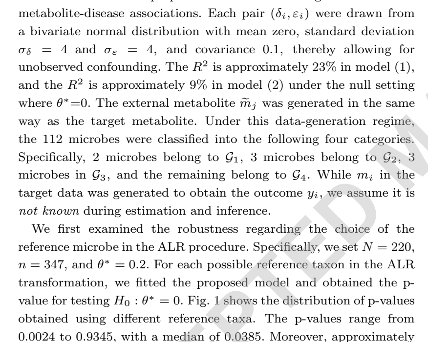
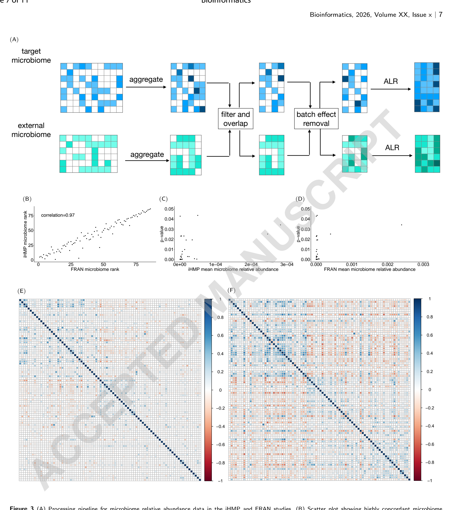
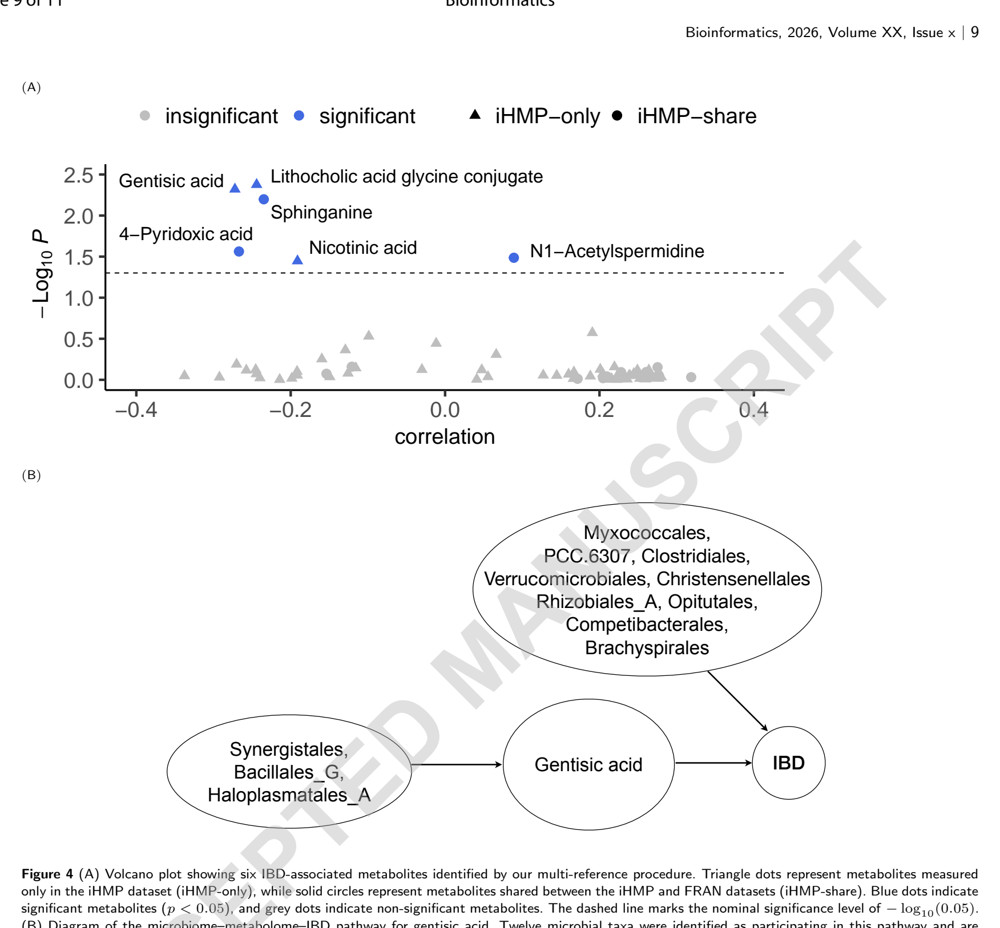

# predmetab：菌群大队列 × 代谢组小队列，"拼"出菌→代谢物→疾病通路

## 工具信息

| 项 | 内容 |
|---|---|
| 名称 | predmetab（R 包，微生物组-代谢组-疾病通路推断） |
| 源码 | https://github.com/lei-fang-stat/MMDP（模拟与 IBD 实战代码同库可复现） |
| 论文 | Fang L, Ye C, Wang Y. *Bioinformatics*. 2026. [doi:10.1093/bioinformatics/btag787](https://doi.org/10.1093/bioinformatics/btag787)（gold OA） |
| 输入 | 目标数据（大队列：菌群 + 连续结局，缺代谢物）+ 外部数据（小队列：菌群-代谢组配对） |
| 输出 | 代谢物对结局的直接效应估计、每个菌的功能角色分型（中介/直通/双面手/无关） |
| 结局类型 | 目前仅支持**连续结局**（二分类为作者列出的未来工作） |

## 工具概述：它解决什么问题

想做"肠道菌 → 代谢物 → 疾病"的通路分析，最常见的困境是数据残缺：最大的临床队列往往只有菌群和结局、没测代谢组；测了菌群-代谢组配对的多组学研究又样本小、表型窄。predmetab 提供统计上的"拼图"方案——**用小队列训练"菌群预测代谢物"的模型，回填大队列再做通路推断**。大量已发表的公共菌群队列（16S/宏基因组 + 表型）可以借此"借"到代谢组维度的推断能力。

## 算法实现

框架把两类数据各就各位，核心三层：

1. **高维结构方程模型（SEM）**：把"菌→代谢物""代谢物+菌→结局"写成联立方程，允许未测混杂（如饮食）同时影响代谢与结局；
2. **两阶段借刀补缺**：第一阶段在外部数据上用 Lasso 训练"菌群→代谢物"预测模型，回填大队列缺失代谢物；第二阶段代入结局方程、同时调整菌群混杂，估计代谢物对结局的直接效应；显著性用适配高维的正则化置换检验；
3. **多参照程序**：组成性数据的对数比（ALR）分析结果依赖"参照菌选谁"——本框架让每个菌轮流当参照，所有参照下的置换 P 值用 Cauchy 组合检验合并，再以稳定性选择给菌定性，结论对参照选择稳健。



*Figure 1 · 换一个参照菌，结论就变——112 个参照下 P 值从 0.0024 到 0.93*

模型会给每个菌自动归入四种功能角色：既推动代谢物又直接影响结局的"双面手"、只通过代谢物起效的"中介通道"、绕开代谢物直接作用的"直通线"、与该通路无关的菌。

**IBD 实战**（论文）：FRAN 队列作目标数据（220 人、IBD 164 例，最终纳入 153 人/111 例，连续结局为粪便钙卫蛋白 FCP）× iHMP 队列作外部数据（基线 104 人/78 例，菌群-代谢组配对）；统一整理后保留 86 个微生物目与 76 个菌群相关代谢物。结果如实说：76 个代谢物中 3 个达名义显著（P<0.05），**FDR 校正后无一存活**；但以龙胆酸通路为例，**3 个菌经龙胆酸间接影响 FCP、9 个菌绕开龙胆酸直接作用**——"谁是中介、谁是干将"被分得清清楚楚。



*Figure 3 · FRAN × iHMP 双队列 IBD 实战分析*



*Figure 4 · 火山图（76 代谢物）与龙胆酸通路的菌群功能分类*

## VibeCoding 实战提示词【未实测】

> 「目标导向」写法：目标、约束、验收标准说清楚，让 AI 代理自行读官方文档与源码执行。**尚未实测**，跑通后去掉本标注。

### ① 环境安装

```text
安装 R 包 predmetab（源码在 github.com/lei-fang-stat/MMDP）。先读该仓库 README，
确认 R 版本与依赖（注意 Lasso/置换检验相关依赖包），在独立 R 库路径下安装，
不要污染系统 R 库。装完加载包并列出它导出的主要函数。
验收：library() 加载无报错，能打印出函数清单。
```

**校验点**：`packageVersion()` 正常返回；导出函数列表里有通路分析主函数。

### ② 输入数据准备

```text
按 MMDP 仓库文档整理两套输入：① 目标数据——菌群丰度表（如 86 个分类单元）
+ 一个连续结局变量 + 样本元数据；② 外部数据——菌群丰度表 + 配对代谢物表。
先用仓库自带的 IBD 示例数据（FRAN × iHMP 整理版）跑通，再换成自己的数据。
验收：两套表行列名规范、无缺失值异常，示例数据可被主函数直接读入。
```

**校验点**：示例数据路径下文件齐全；主函数读入时不报维度/命名错误。

### ③ 跑通路分析并解读

```text
用 predmetab 对示例数据做通路推断：输出代谢物对结局的效应估计与 P 值、
每个菌的功能角色分类（双面手/中介/直通/无关）。把结果整理成两张表：
① 代谢物效应表（含多参照合并后的 P 值）；② 菌角色分类表。
对照论文（doi:10.1093/bioinformatics/btag787）的 IBD 结果，核对我复现出的
龙胆酸通路"3 中介 + 9 直通"是否一致，不一致处列出可能原因。
验收：两张表生成，且与论文报告的方向一致。
```

**校验点**：效应表 P 值分布在 [0,1]；角色分类覆盖全部输入菌；与论文对照无方向性矛盾。

### ④ 换成自己的数据

```text
我的目标数据是 <你的队列描述：n 例、结局变量名、菌群数据类型>，外部数据是 <…>。
请检查两套数据的可迁移性（分类单元交集、丰度分布、结局类型是否连续），
指出不满足框架假设的地方并给出预处理建议，再执行分析。
```

**校验点**：迁移性体检结果（交集比例、分布差异）先于模型输出呈现。

## 常见坑与注意事项（来自论文自陈的局限）

1. 正则化置换检验偏保守，功效受损，去偏 Lasso 类修正尚无现成适配；
2. Cauchy 组合可能被单个极小 P 值主导；
3. 只支持连续结局；二分类需新方法（作者未来工作）；
4. 多个外部队列可用时目前只用一个，按信息量加权整合是改进方向；
5. FDR 后无一存活在真实数据里是真实可能的结果——如实报告，不要为了"出显著"挑选口径（原文敏感性分析中显著数在 3–6 个间波动、仅 2 个稳定复现）。

---

> 本文首发于微信公众号「肠动心弦」。由 AI 辅助整理并经人工核校，内容以英文原文与工具官方文档为准；解读仅代表本号观点。图表引自 Fang et al., *Bioinformatics* 2026（gold OA，转载须署名原作者）。
