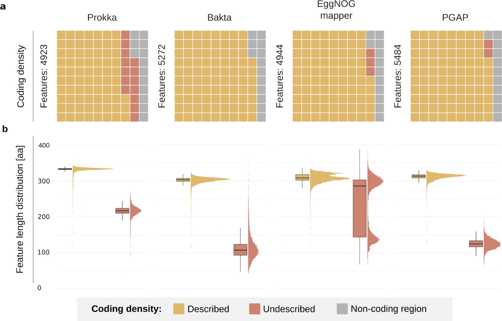
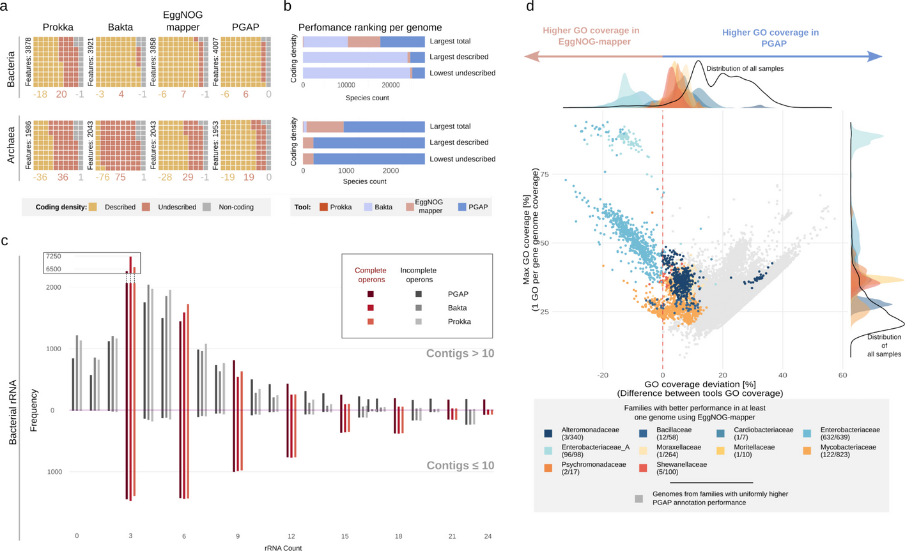
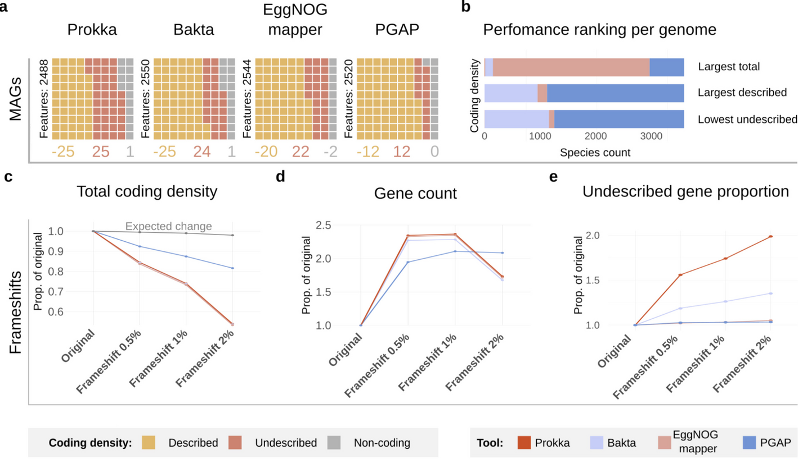

# 原核注释工具怎么选：156,033 个基因组的基准评测

> Prokka / Bakta / EggNOG-mapper / PGAP 分场景选型 ｜ Genome Biology · 2026 ｜ [论文原文](https://doi.org/10.1186/s13059-026-04262-0)
>
> 本文首发于微信公众号「肠动心弦」。

---

**Genome Biology · 2026 · Research · 生信（工具基准评测）**

> **导读**：Prokka、Bakta、EggNOG-mapper、PGAP——做原核基因组注释，几乎绕不开这四款工具，但"到底该用哪个"一直缺少系统性答案。耶拿大学医院团队在 **156,033 个基因组**上完成了首个大规模基准评测：没有全能冠军，高质量细菌分离株选 Bakta，古菌与 MAG/碎片基因组选 PGAP，功能注释看"覆盖广度"选 PGAP、看"词条丰度"选 EggNOG-mapper。

## 评测怎么做的：四款工具，四块数据，三组指标

*Figure 1 · 评测设计与数据集全景*

先交代四位选手的定位。**Prokka**（2014，引用约 19,000 次）：轻量快速，数据库不到 1 GB；**Bakta**（2021，约 1,400 次）：数据库覆盖面大、输出规范；**EggNOG-mapper**（约 4,800 次）：走直系同源推断路线，只注释编码序列（CDS）、不管 RNA；**PGAP**（约 7,300 次）：NCBI 内部流水线，按物种定制注释策略，但需要事先提供分类信息。

数据集四块：**GTDB r207 代表物种 29,761 个**（细菌 163 门 26,970 + 古菌 20 门 2,791）；**大肠杆菌 24,393 株**做低分类变异、研究充分的"基线参照"；**人工移码模拟基因组 98,742 个**（对 32,914 个基因组做 0.5%、1%、2% 随机缺失，模拟测序错误）；**高质量细菌 MAG 3,137 个**（分属不同科，平均完整度 85.22%、污染 1.67%）。

评测指标三组，都翻译成大白话：**编码密度**看三样——总编码密度（ORF 检测能力）、已描述编码密度（多少检测出的基因"叫得出名字"）、未描述编码密度（多少只能含糊标"假定蛋白"）；**RNA 特征**（rRNA/tRNA/tmRNA）对照研究验证过的生物学期望来判对错（如细菌 tmRNA 通常单拷贝、大肠杆菌应有 22 个 rRNA 基因）；**GO 功能注释**分覆盖率（多少基因至少分到一个 GO 词条）与丰度（每基因平均多少词条）。

## 大肠杆菌基线：细节里全是"没有完美选手"

*Figure 2 · 大肠杆菌编码密度与基因长度分布*

总编码密度四家接近（PGAP 平均最高，约 470.9 万 bp；其余三家约 446–450 万 bp），差距拉开在"描述能力"上：**已描述编码密度 Bakta 第一**（平均 448.5 万 bp），PGAP、EggNOG-mapper 随后，而 Prokka 只有 371.5 万 bp——大量基因只能标"假定蛋白"（未描述区平均 74.1 万 bp，是 Bakta 的 62 倍；Bakta 仅 1.2 万 bp）。**有数据库登录号的特征占比**上 PGAP 最高（RefSeq 92.50%），Bakta（UniRef50 91.48%）、EggNOG-mapper（PFAM 90.39%）紧随。

RNA 特征暴露了各自的软肋。以 22 个 rRNA 基因的期望值看，没有任何一家能稳定全对（均值：PGAP 13.89、Prokka 10.35、Bakta 9.60）；在组装完整的基因组（≤10 contigs）里三家都能接近 22 个全对，而一旦碎片化（>10 contigs）就明显掉链子——此时 **PGAP 仍能平均检出 12.96 个**，Prokka 和 Bakta 只剩约 8–9 个。tRNA 三家都接近期望（78.7–81.7 vs 期望 79）。tmRNA 期望单拷贝：Prokka 和 Bakta 在 62 个基因组中漏检，PGAP 仅 15 个；但 PGAP 也在 127 个基因组里多报了——高灵敏度似乎附带高误报（推断），细节里没有完美选手。

GO 注释在基线上是 EggNOG-mapper 的主场：覆盖率 66.07%（Bakta 63.88%、PGAP 36.12%），丰度每基因 37.0 个词条，碾压 Bakta（4.0）与 PGAP（2.0）。注意两点公平性说明：Prokka 不输出 GO 词条，不参与比较；EggNOG-mapper 默认设置只保留"非电子注释"的 GO 词条。

## 跨 183 个门：Bakta 与 PGAP 分治细菌，古菌是 PGAP 的天下

*Figure 3 · 分类学维度表现*

把镜头拉到整个分类学广度，总编码密度（88.01%–88.85%）与文献的 87% 相符，但"已描述"比例随分类距离明显下滑，古菌尤甚。按"每个物种谁最佳"统计：

- **细菌总编码密度**：PGAP（9,870 个物种）与 Bakta（9,852）几乎平分秋色，EggNOG-mapper 7,169，Prokka 79；
- **细菌已描述编码密度**：**Bakta 一家拿下 23,121/26,970 个物种**（PGAP 3,251、EggNOG-mapper 596）——高质量细菌分离株选 Bakta 的依据就在这里；
- **古菌**：PGAP 总数第一（1,858/2,791）且已描述第一（2,549）——已描述指标上 Bakta 与 Prokka 未在任何一个物种领先（总编码密度上 Bakta 仍领先 72 个物种、Prokka 8 个）。（作者注明：Bakta 并不官方支持古菌，这部分结果需谨慎解读。）

GO 侧出现"覆盖与丰度"的分野：**覆盖率上 PGAP 在细菌无一科被 Bakta 反超**（平均 31.20% vs 2.40%），在古菌同样第一（20.03% vs EggNOG-mapper 5.80%、Bakta 0.13%）；但 EggNOG-mapper 在 10 个细菌科的部分基因组中覆盖率反超 PGAP——其中包括**肠杆菌科、分枝杆菌科、芽孢杆菌科**这些临床相关类群。丰度则始终是 EggNOG-mapper 最高（细菌平均 35.40 词条/基因 vs PGAP 2.03）。一句话：要让更多基因"至少有个功能标签"选 PGAP；要给已注释基因更丰富的功能描述选 EggNOG-mapper，二者可以互补。

## MAG 与移码：谁最"扛造"？

*Figure 4 · MAG 与移码对注释质量的影响*

MAG 是宏基因组研究的日常，也是注释工具的试金石。在 3,137 个高质量细菌 MAG 上，"已描述→未描述"的滑坡比分类学效应更猛：**Bakta 的未描述区增幅最大**，而 **PGAP 在 MAG 上反而拿下"最大已描述 + 最小未描述"**；GO 覆盖率 PGAP 31.54%，EggNOG-mapper 掉到 6.95%，Bakta 仅 0.18%。

更极端的考验是人工移码。0.5% 随机缺失时，Prokka、Bakta、EggNOG-mapper 的特征数**翻倍**——它们能把基因碎片检出来，但拆成了多条零散注释；缺失加到 2% 时碎片太碎、连特征数都开始下降。**PGAP 是另一套行为**：编码密度降幅最小、特征数增幅也最小，因为它能把同一基因的碎片**合并回单一特征**再注释（这得益于 PGAP 内置的 ORFfinder 与 ProSplign 移码检测）。对 MAG、短读组装、可疑污染这类"问题基因组"，PGAP 的鲁棒性是最突出的卖点。

## 工程实操：算力、更新与一张决策树

*Figure 5 · 选型决策树*

资源账本（Table 1 摘要）：中位 CPU 时间 **Prokka 3.2 分钟、EggNOG-mapper 15.6、Bakta 36.8、PGAP 106.6**——PGAP 大规模本地部署成本可观；内存上 EggNOG-mapper 最吃 RAM（本评测实测中位 41.7 GB——注意这已经是在其 --dbmem 高内存模式下测得，该模式硬件要求 44–48 GB）；数据库方面 Bakta 约 59.4 GB、EggNOG-mapper 约 51 GB、PGAP 约 30.4 GB，Prokka 不到 1 GB。

两个实用提醒：其一，**Prokka 总体不再推荐**——其捆绑数据库自 2019 年 11 月后未再更新；作者转述 Prokka 作者本人的建议：低资源场景改用 Bakta 的 light 数据库。其二，**注释工具要勤更新**：作者对比 GTDB 里旧版 PGAP 注释，发现新版平均多检出 139.8 个特征（SD=134.79）——数据库随时间增值明显。硬件受限时可考虑在线版（EggNOG-mapper、Bakta），质量与本地执行相当。

作者把全部结论浓缩成一张**选型决策树**（图 5）：高质量细菌分离株、目标是最大化已描述功能 → Bakta；古菌或问题基因组（MAG、碎片、污染、移码）→ PGAP；功能注释要覆盖广度 → PGAP，要词条丰富 → EggNOG-mapper（特定类群可用二者互补）；低资源环境 → Bakta light 或在线版。

## 总结与展望

- **核心结论**：没有放之四海皆准的注释工具，选型要看"分类 × 基因组质量 × 研究目标"三个变量的组合；
- **方法学提醒**（作者观点）：使用、评测或开发注释工具时，都应把分类、测序技术、样本质量与数据库版本纳入考量；
- **对下一代工具的期待**（作者展望）：从孤立的基因发现走向统一、可比较的框架（统一输出格式、多工具整合）；把 AlphaFold 类结构预测引入同源搜索失效时的功能推断；从注释单基因走向建模整个转录单元（启动子、RBS、终止子）。

## 局限性（作者散见陈述）

1. 大规模、分类多样的数据集**缺乏金标准**，作者以研究验证的生物学期望（tmRNA 单拷贝、rRNA 操纵子完整性等）作替代锚点；
2. **Bakta 不官方支持古菌**，古菌部分的对比结果需谨慎解读；
3. **EggNOG-mapper 按默认设置**仅保留非电子 GO 词条，GO 比较存在设定上的不对等；
4. 依赖外部服务器的工具（如 RAST）因无法本地大规模部署被排除在评测之外；
5. 分类框架选用 GTDB（而非 NCBI），参考数据库与分类选择本身会影响注释结果。

## 参考文献

1. Jundzill M, Hölzer M, Mangul S, et al. Large-scale benchmarking of prokaryotic annotation tools across thousands of species. *Genome Biol*. 2026;27:284. doi:10.1186/s13059-026-04262-0（原文）
2. Seemann T. Prokka: rapid prokaryotic genome annotation. *Bioinformatics*. 2014;30:2068–2069.
3. Schwengers O, et al. Bakta: rapid and standardized annotation of bacterial genomes via alignment-free sequence identification. *Microb Genomics*. 2021;7:000685.
4. Cantalapiedra CP, Hernández-Plaza A, Letunic I, Bork P, Huerta-Cepas J. EggNOG-mapper v2: functional annotation, orthology assignments, and domain prediction at the metagenomic scale. *Mol Biol Evol*. 2021;38:5825–5829.
5. Tatusova T, et al. NCBI prokaryotic genome annotation pipeline. *Nucleic Acids Res*. 2016;44:6614–6624.

---

原文：https://doi.org/10.1186/s13059-026-04262-0

> 本文由 AI 辅助整理，发布前经人工核校；内容以英文原文为准；解读仅代表本号观点，不构成任何医疗建议。文中图表引自 Jundzill et al., *Genome Biol* 2026（CC BY 4.0，原样使用，仅作学术交流）。

你平时用哪款注释工具？被"假定蛋白"淹没过吗？评论区聊聊👇
